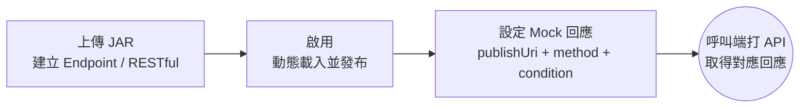
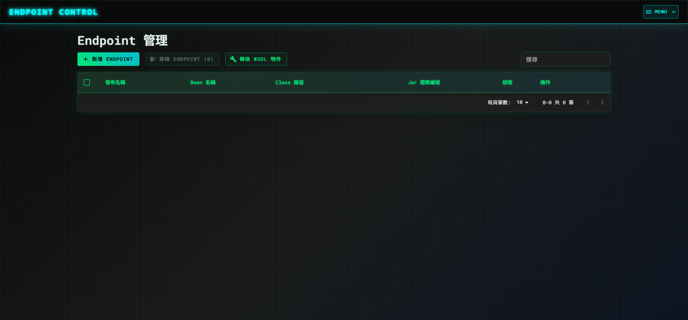
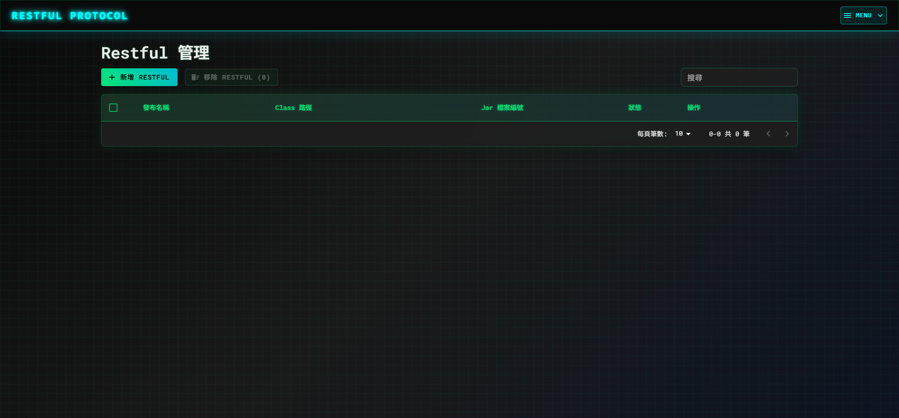
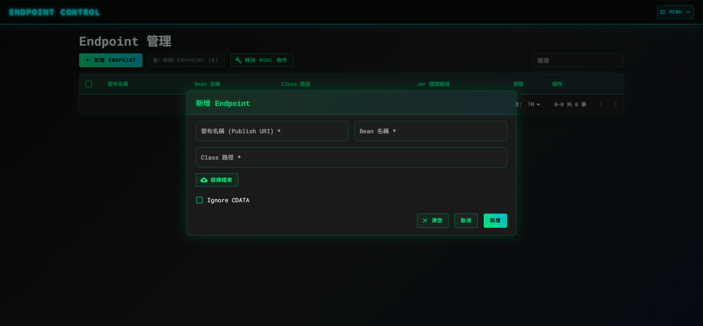
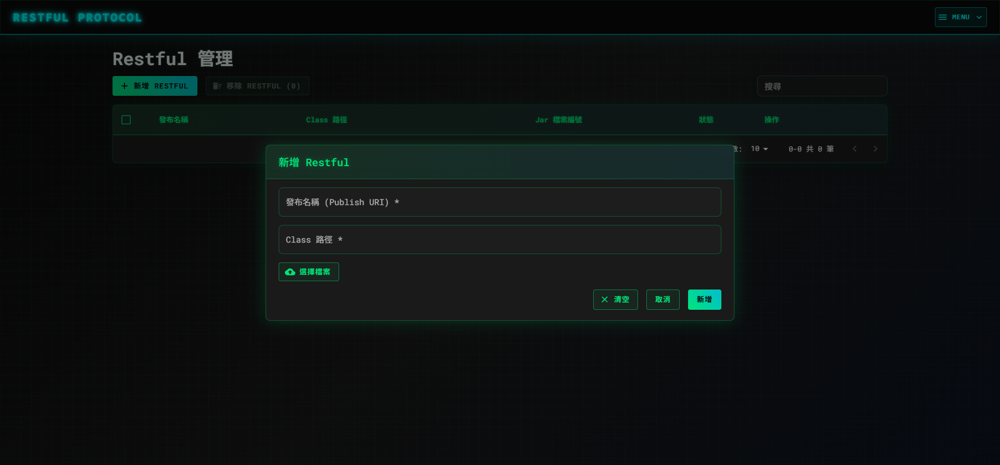

# Dynamic API Manager

Mock API 伺服器：上傳含有 SOAP Web Service 或 Spring `@RestController` 的 JAR，系統在**不重啟**的情況下動態發布服務；服務被呼叫時，依 JAR 程式決定的 `publishUri`、`method`、`condition` 從資料庫找出預先設定的回應並回傳。

適合「下游系統還沒好，但要先開發或測試」的情境，例如對方只給了 WSDL、測試環境還沒開，或需要一組可切換成功／失敗／邊界情境的 REST API。

📖 **完整文件**：<https://a09090443.github.io/dynamic-api/>（使用者指南、JAR 開發指南、需求規格書、設計規格書）

> [!WARNING]
> 系統沒有任何認證機制，任何能連到管理 API 的人都能上傳並執行 Java 程式碼。只能部署在受信任的內部網路。

## 運作方式



- **SOAP**：以 Apache CXF 發布到 `/dynamic-api/webservice/{publishUri}`，WSDL 加上 `?wsdl`
- **RESTful**：直接註冊進 Spring MVC，網址為 `/dynamic-api/{publishUri}/...`
- **Mock 回應**：`publishUri`、`method`、`condition`、`serviceType` 四個鍵完全相等且已啟用才會命中

## 專案結構

| 目錄 | 說明 |
|---|---|
| `backend/` | Spring Boot 3.2.5（Java 17）：動態載入、管理 API、內嵌 SQLite + Flyway |
| `nextjs-dynamic-api-manager/` | 管理介面（Next.js 15.5.4 + MUI 7），生產模式靜態匯出並打包進後端 |
| `base-jar/` | 自訂 JAR 編譯用的 `RestfulBase`、`WebserviceBase`、`MockResponseDao` |
| `endpoints/`、`restfuls/` | 自訂 JAR 範例（`company-endpoint`、`company-restful`、`example-restful`） |
| `docs-site/` | 文件網站（Docusaurus），`master` 有變更時自動發布到 GitHub Pages |
| `postman/` | 管理 API 與 SOAP 呼叫範例集合 |
| `tools/` | Gradle 前端建置使用的 Windows 版 Node.js 22 |
| `frontend/` | 舊版 Angular 管理介面，已不使用 |

## 環境需求

| 項目 | 版本 |
|---|---|
| JDK | 17（範例 JAR 以 toolchain 指定 17） |
| Node.js | 22（Windows 上 Gradle 使用 `tools/` 內附版本；手動跑前端或文件網站時需自行安裝） |
| Gradle | 不需安裝，各模組附 Gradle Wrapper |
| 作業系統 | Windows（建議）；macOS / Linux 見下方說明 |

## 快速啟動

> [!IMPORTANT]
> 預設設定把資料庫、上傳的 JAR、日誌放在 `D:/tmp/`、`C:/tmp/`。第一次啟動前請確認目錄存在，或修改 `backend/src/main/resources/*.properties`（見 [設定參考](https://a09090443.github.io/dynamic-api/docs/guide/configuration)）。

### 生產模式（建議先用這個）

```powershell
cd backend
.\gradlew.bat bootRun
```

`bootRun` 每次都會先執行前端依賴安裝檢查與建置，可能需要數分鐘；只開發後端可使用下方略過前端建置的命令。詳見 [建置緩慢排查](./docs-site/docs/guide/troubleshooting.md)。啟動後開啟 <http://localhost:8080/dynamic-api/>。

產出可部署的 JAR：

```powershell
cd backend
.\gradlew.bat bootJar            # 使用 pro 設定：.\gradlew.bat bootJar -Penv=pro
java -jar build\libs\backend-0.0.1-SNAPSHOT.jar
```

### 開發模式（前端熱更新）

先在 `nextjs-dynamic-api-manager/` 建立 `.env.local`（Next.js 的 API 代理路由已移除，必須讓前端直接呼叫後端）：

```properties
NEXT_PUBLIC_API_URL=http://localhost:8080
```

```powershell
# 終端機 1：後端
cd backend
.\gradlew.bat bootRun -x buildFrontend

# 終端機 2：前端
cd nextjs-dynamic-api-manager
npm install   # 第一次
npm run dev
```

開啟 <http://localhost:3000/endpoint>。

### VS Code 執行／偵錯

安裝 **Extension Pack for Java**，確認 `.vscode/settings.json` 的 JDK 17 路徑符合本機環境，執行 `Developer: Reload Window`。等待 Java 專案匯入後，在 **Run and Debug** 選擇 **Dynamic API：後端**、**Dynamic API：前端** 或 **Dynamic API：前後端**，按 **F5**。前端第一次先執行 `Tasks: Run Task` → **Dynamic API：安裝前端依賴**；完整設定見 [安裝與啟動](./docs-site/docs/guide/installation.md)。

### macOS / Linux

前端建置任務寫死使用 Windows 版 Node，直接 `./gradlew bootRun` 會失敗。請先手動建置前端，再略過 Gradle 的前端任務：

```bash
cd nextjs-dynamic-api-manager
npm install && NODE_ENV=production npm run build
mkdir -p ../backend/src/main/resources/static
cp -r out/* ../backend/src/main/resources/static/

cd ../backend
./gradlew bootRun -x buildFrontend
```

同時把 `*.properties` 裡的 `D:/`、`C:/` 路徑改成該系統可用的路徑。

### 確認服務正常

```bash
curl http://localhost:8080/dynamic-api/ws/getEndpoints
# {"code":200,"message":"OK","data":[]}
```

## 部署第一個 Mock API

以內附的 `restfuls/company-restful` 為例（完整步驟見 [快速上手](https://a09090443.github.io/dynamic-api/docs/guide/quick-start)）：

1. **建置 JAR**：`cd restfuls\company-restful` → `.\gradlew.bat jar`，上傳的是 `build\libs\company-restful-1.0-plain.jar`（不是 `bootJar` 產生的 fat JAR）。
2. **建立 RESTful**：管理介面 **RESTful** → **新增**，Publish URI 填 `company`（必須等於 Controller `@RequestMapping` 路徑的第一段），Class 路徑填 `com.company.controller.CompanyController`，選擇 JAR 後儲存，再打開啟用開關。
3. **新增 Mock 回應**：該列的 **回應清單** → **新增**，呼叫方法名稱填 `getResponseData`，條件填請求的 JSON 字串（可從後端日誌 `request json:` 複製），儲存後打開啟用開關。
4. **呼叫**：

   ```bash
   curl -X POST http://localhost:8080/dynamic-api/company/data \
     -H "Content-Type: application/json" -d '{"name":"Acme"}'
   ```

Endpoint、RESTful、Mock 回應新建或編輯後一律為**停用**，記得打開開關。

## 撰寫自己的 JAR

```java
@RestController
@RequestMapping("/company")                 // 第一段 = Publish URI
public class CompanyController extends RestfulBase {

    @PostMapping("/data")
    public String getData(@RequestBody String body) {
        // 依 publishUri、method、condition 查詢 Mock 回應
        return findByPrimaryKey("company", "getData", body, String.class);
    }
}
```

- RESTful 繼承 `RestfulBase`，SOAP 繼承 `WebserviceBase`（皆在 `base-jar`）。
- 每個服務有自己的 ClassLoader 且「父優先」；系統只載入 JAR 內你的類別，不會載入它的相依套件。
- `condition` 由程式產生、由維護者在管理介面手動輸入，比對方式是字串完全相等，請把格式寫清楚。

詳見 [JAR 開發指南](https://a09090443.github.io/dynamic-api/docs/jar-dev/overview)。

## 常用命令

| 目的 | 命令 |
|---|---|
| 啟動後端（含前端建置） | `cd backend && .\gradlew.bat bootRun` |
| 只改後端、略過前端建置 | `.\gradlew.bat bootRun -x buildFrontend` |
| 後端測試 | `cd backend && .\gradlew.bat test` |
| 前端檢查 | `cd nextjs-dynamic-api-manager && npm run type-check && npm run lint` |
| 文件網站 | `cd docs-site && npm start`（<http://localhost:3000/dynamic-api/>；與 Next.js 同時啟動時加 `-- --port 3001`） |
| 文件網站建置驗證 | `cd docs-site && npm run build` |
| 範例 JAR | `.\gradlew.bat jar`，上傳 `build/libs/*-plain.jar` |

## 文件導覽

| 需要 | 文件 |
|---|---|
| 安裝、操作、設定 | [使用者指南](https://a09090443.github.io/dynamic-api/docs/guide/overview) |
| 已知問題與排查 | [疑難排解與已知問題](https://a09090443.github.io/dynamic-api/docs/guide/troubleshooting) |
| 自訂 JAR | [JAR 開發指南](https://a09090443.github.io/dynamic-api/docs/jar-dev/overview) |
| 管理 API 規格 | [管理 API 概述與慣例](https://a09090443.github.io/dynamic-api/docs/sdd/api/conventions) |
| 需求與設計 | [需求規格書](https://a09090443.github.io/dynamic-api/docs/srs/intro)、[設計規格書](https://a09090443.github.io/dynamic-api/docs/sdd/intro) |
| 給 AI 讀取 | [llms.txt](https://a09090443.github.io/dynamic-api/llms.txt)、[llms-full.txt](https://a09090443.github.io/dynamic-api/llms-full.txt) |
| 給 AI coding agent | [AGENTS.md](./AGENTS.md) |

## 運行畫面

| Endpoint 管理 | RESTful 管理 |
|---|---|
|  |  |

| 新增 Endpoint | 新增 RESTful |
|---|---|
|  |  |

## 聯絡方式

如有興趣討論，或有想法想加入開發，歡迎來信：<zipe.daden@gmail.com>
