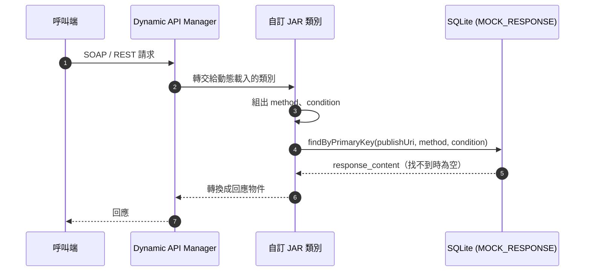

# 系統簡介與核心概念

## 系統由哪些部分組成

| 元件 | 目錄 | 說明 |
|---|---|---|
| 後端服務 | `backend/` | Spring Boot 3.2.5（Java 17）。負責動態載入 JAR、發布服務、提供管理 API，並內嵌 SQLite。 |
| 管理介面 | `nextjs-dynamic-api-manager/` | Next.js 15 + MUI。生產模式下會被靜態匯出並打包進後端 JAR。 |
| base-jar | `base-jar/` | 提供 `WebserviceBase`、`RestfulBase`、`MockResponseDao` 給自訂 JAR 編譯時使用。 |
| 範例 JAR | `endpoints/company-endpoint/`、`restfuls/company-restful/`、`restfuls/example-restful/` | 可直接建置、上傳試用的範例。 |
| 文件網站 | `docs-site/` | 本網站（Docusaurus）。 |

:::note 舊版前端
`frontend/` 目錄是先前的 Angular 管理介面，已由 `nextjs-dynamic-api-manager/` 取代，後端建置流程不會再使用它。
:::

## 核心概念

### Endpoint（SOAP Web Service）

一個 Endpoint 代表一個從 JAR 載入、透過 Apache CXF 發布的 JAX-WS 服務。建立時需要提供：

| 欄位 | 意義 | 範例 |
|---|---|---|
| Publish URI | 發布路徑，也是 Mock 回應的分組鍵 | `company` |
| Bean 名稱 | 註冊到 Spring 容器的 Bean 名稱，不可與既有 Bean 重複 | `companyWebServiceImpl` |
| Class 路徑 | 實作類別的完整類別名稱 | `com.company.webservice.impl.CompanyWebServiceImpl` |
| JAR 檔案 | 含有上述類別的 JAR | `company-endpoint-0.0.1-plain.jar` |
| Ignore CDATA | 是否啟用 CDATA 轉義處理（見 [管理 Endpoint](./endpoint.md#ignore-cdata)） | 關閉 |

發布後的位址：`http://localhost:8080/dynamic-api/webservice/{publishUri}`，WSDL 加上 `?wsdl`。

### RESTful（Spring Controller）

一個 RESTful 項目代表一個從 JAR 載入、標註 `@RestController` 的類別，其方法會被註冊到 Spring MVC。建立時需要提供 Publish URI、Class 路徑與 JAR 檔案。

:::warning Publish URI 必須等於類別路徑的第一段
若 Controller 類別上有 `@RequestMapping("/company")`，Publish URI 就必須填 `company`，否則啟用時會失敗（「路徑不一致」）。
:::

### Mock 回應

Mock 回應存放在資料庫，以四個欄位唯一識別：

| 欄位 | 由誰決定 | 說明 |
|---|---|---|
| `publishUri` | 管理介面自動帶入 | 對應 Endpoint / RESTful 的 Publish URI |
| `method` | JAR 程式碼 | 通常是方法名稱，例如 `getCompany` |
| `condition` | JAR 程式碼 | 用來區分情境的字串，範例 JAR 使用「請求物件序列化成的 JSON」 |
| `serviceType` | 管理介面自動帶入 | `ENDPOINT` 或 `RESTFUL` |

JAR 在收到請求時，自行組出 `method` 與 `condition`，呼叫 `findByPrimaryKey(...)` 查詢；**字串完全相同**且回應為**啟用**狀態才會命中。細節請看 [管理 Mock 回應](./mock-response.md) 與 [Condition 設計指南](../jar-dev/condition-design.md)。

### 啟用狀態

Endpoint、RESTful、Mock 回應三者**新建時預設都是停用**，需要在管理介面手動打開開關。系統重新啟動時，會自動把資料庫中標記為啟用的 Endpoint 與 RESTful 重新載入；載入失敗的項目會被自動改為停用。

## 一次請求的處理過程

