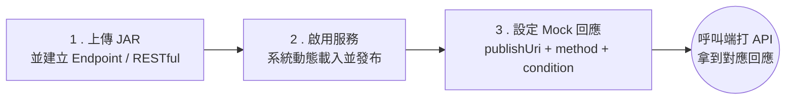

# Dynamic API Manager 文件

Dynamic API Manager 是一套 **Mock API 伺服器**：你把含有 SOAP Web Service 或 Spring RESTful Controller 的 JAR 上傳到系統，它會在**不重啟**的情況下把服務發布出去；服務被呼叫時，會依請求內容從資料庫找出你預先設定好的回應並回傳。

適合用在「下游系統還沒好、但我要先開發或測試」的情境，例如：

- 串接外部 SOAP 服務，但對方只給了 WSDL，測試環境還沒開。
- 前端或其他服務需要一組可控、可切換情境的 REST API。
- 想用同一個介面，依不同請求參數回傳成功、失敗、邊界值等多種回應。

## 三步驟看懂系統怎麼運作

1. **上傳 JAR**：JAR 內的類別繼承系統提供的 `WebserviceBase` 或 `RestfulBase`。
2. **啟用服務**：SOAP 服務以 Apache CXF 發布到 `/dynamic-api/webservice/{publishUri}`；RESTful Controller 直接註冊進 Spring MVC。
3. **設定 Mock 回應**：JAR 程式在收到請求時，用 `publishUri`、`method`、`condition` 三個鍵去資料庫查回應內容。

## 該從哪裡開始讀

| 你是… | 建議閱讀 |
|---|---|
| 第一次接觸、想先跑起來 | [系統簡介](./guide/overview.md) → [安裝與啟動](./guide/installation.md) → [快速上手](./guide/quick-start.md) |
| 測試人員，要維護 Mock 回應 | [管理 Mock 回應](./guide/mock-response.md)、[疑難排解](./guide/troubleshooting.md) |
| 開發人員，要寫自己的 JAR | [JAR 開發總覽](./jar-dev/overview.md) → [RESTful JAR](./jar-dev/restful-jar.md) / [Endpoint JAR](./jar-dev/endpoint-jar.md) |
| 要直接呼叫管理 API（Postman、CI） | [管理 API 慣例](./sdd/api/conventions.md) |
| 架構師、維護者 | [需求規格書 (SRS)](./srs/intro.md)、[設計規格書 (SDD)](./sdd/intro.md) |

## 重要網址（預設設定）

| 用途 | 網址 |
|---|---|
| 管理介面（生產模式） | `http://localhost:8080/dynamic-api/` |
| 管理介面（前端開發模式） | `http://localhost:3000/endpoint` |
| SOAP 服務 WSDL | `http://localhost:8080/dynamic-api/webservice/{publishUri}?wsdl` |
| RESTful 服務 | `http://localhost:8080/dynamic-api/{publishUri}/...` |
| 管理 API 前綴 | `http://localhost:8080/dynamic-api/ws`、`/api`、`/common` |

:::info 文件版本
本文件依 `new-frontend` 分支的程式碼撰寫（Spring Boot 3.2.5、Next.js 15.5.4）。文件中標示「已知問題」的項目，代表目前程式行為與預期不一致，修正前請依文件提供的替代方式操作。
:::
