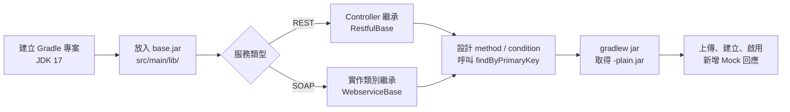

# JAR 開發總覽

本指南說明如何撰寫可以被 Dynamic API Manager 動態載入的 JAR。寫作對象是熟悉 Spring Boot 或 JAX-WS 的 Java 開發人員。

## 開發流程

| 步驟 | 文件 |
|---|---|
| 取得基礎類別 | [base-jar 與 Mock 查詢 API](./base-jar.md) |
| 寫 REST 服務 | [開發 RESTful JAR](./restful-jar.md) |
| 寫 SOAP 服務 | [開發 Endpoint JAR](./endpoint-jar.md) |
| 決定回應怎麼對應 | [Condition 設計指南](./condition-design.md) |
| 打包與上線 | [打包、上傳與驗證](./build-deploy.md) |

## 你的 JAR 在系統裡怎麼被執行

理解下面四點，可以避開大多數載入問題。

### 1. 每個服務有自己的 ClassLoader，而且「父優先」

系統為每個 Endpoint / RESTful 建立一個 `CustomClassLoader`，父載入器是後端應用本身。載入類別時**先問後端**，後端沒有才從你的 JAR 找。

這代表：

- Spring、CXF、Jackson、Lombok 執行期類別、zipe starter 工具類等**一律使用後端的版本**，你在 JAR 專案中宣告的版本只影響編譯。
- `com.dynamicapi.*`（`RestfulBase`、`WebserviceBase`、`MockResponseDao`…）也是用後端內建的那一份，所以 `base.jar` 只是讓你能編譯。
- 不同服務的 JAR 可以有同名類別（例如兩個 JAR 都有 `com.company.dto.CompanyDTO`），彼此不會衝突。
- 但如果你的類別和**後端**的類別同名，會被後端的版本蓋掉。請使用自己的套件名稱。

### 2. 只會載入你的類別，不會載入你的相依套件

上傳的是 `-plain.jar`，裡面只有你自己編譯出的類別。執行期能用的第三方套件，就是後端 classpath 上有的那些。

### 3. 你的類別由 Spring 建立，可以注入後端的 Bean

| 類型 | 建立方式 | 結果 |
|---|---|---|
| RESTful | `AutowireCapableBeanFactory.createBean(類別)` | 會執行 `@Autowired` 注入 |
| Endpoint | 以你指定的 Bean 名稱註冊 Bean Definition 後 `getBean` | 會執行 `@Autowired` 注入，並成為具名 Bean |

基底類別就是靠這個機制拿到 `MockResponseDao`。你也可以注入後端的其他 Bean（例如 `ObjectMapper`），但這會讓 JAR 和後端內部實作綁在一起，建議只依賴 `base.jar` 提供的 API。

類別上的 `@Component` 不會產生作用（系統不做元件掃描），有沒有加都可以。

### 4. 回應內容由你的程式決定

系統不會自動比對請求、也不會自動轉換回應。你的程式要：

1. 從請求組出 `method` 與 `condition` 字串。
2. 呼叫 `findByPrimaryKey(...)` 取得資料庫中的 `response_content`。
3. 把它轉換成方法的回傳型別。

這讓你可以完全控制比對邏輯，代價是需要和維護 Mock 回應的人約定好字串格式。

## 可以使用哪些套件

執行期可用（由後端提供）的主要套件：

| 類別 | 套件 |
|---|---|
| Web | Spring Boot 3.2.5（Spring MVC、Jakarta Servlet） |
| SOAP | Apache CXF 4.0（JAX-WS、JAXB） |
| JSON / XML | Jackson（含 `jackson-dataformat-xml`，由 zipe starter 帶入） |
| 工具 | `io.github.a09090443` 的 base / web / db / web-service starter（`XmlUtil`、`SoapUtil`、`@ResponseResultBody` 等） |
| 其他 | Apache Commons Lang、HttpClient 4.5、JasperReports、OpenPDF、EclipseLink |

需要其他套件時，有兩個選擇：

1. 把套件加進 `backend/build.gradle`，重新部署後端（影響所有服務）。
2. 用 Shadow 之類的工具把套件**攤平**打進你的 JAR（注意不要打包已存在於後端的套件，以免版本混雜）。

## 範例專案

| 專案 | 類型 | 重點 |
|---|---|---|
| `restfuls/company-restful` | RESTful | 最小可用範例，請求 JSON 當 condition |
| `restfuls/example-restful` | RESTful（Maven） | 同時示範不查 Mock 的固定回應 `GET /example/response` |
| `endpoints/company-endpoint` | Endpoint | 從 WSDL 產生的 JAXB 類別、以 SOAP XML 當回應內容 |
