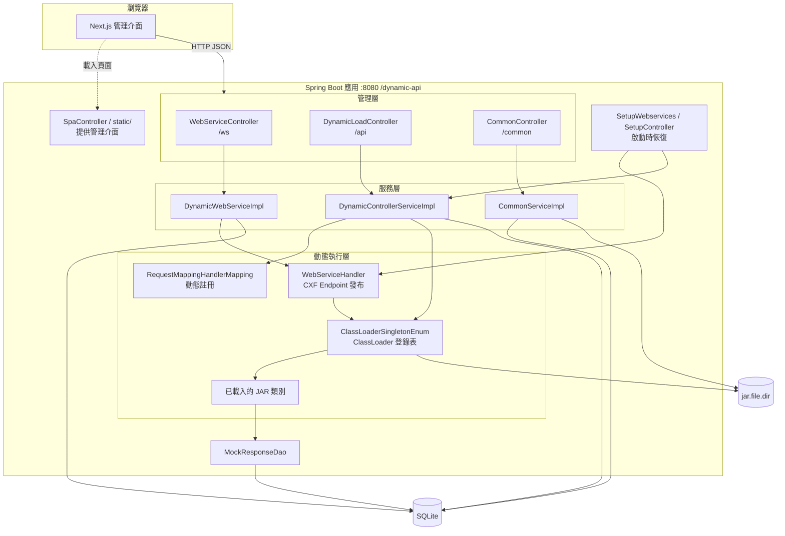
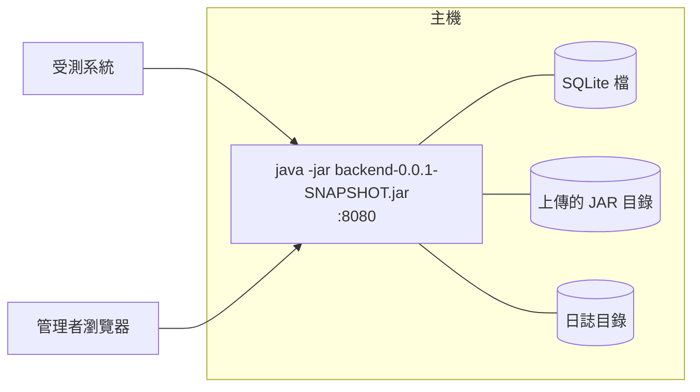

# 2. 系統總體設計

## 2.1 架構概覽

系統是一個單體 Spring Boot 應用，內含四個邏輯區塊：

| 區塊 | 職責 |
|---|---|
| 管理層 | 對前端提供 REST 管理 API，負責基本驗證與流程編排（例如編輯時的停用→儲存→搬移回應） |
| 服務層 | 資料存取與交易、呼叫動態執行層 |
| 動態執行層 | 建立 ClassLoader、發布 CXF 服務、註冊 Spring MVC 對應 |
| 啟動恢復 | `SmartLifecycle` 元件，於啟動時重新發布啟用中的服務 |

## 2.2 部署拓撲

單機、單行程部署：

系統狀態分散在三處：**SQLite**（設定與回應）、**JAR 目錄**（類別）、**JVM 記憶體**（已載入的 ClassLoader 與已註冊的服務）。前兩者持久化，第三者在啟動時由前兩者重建。因此無法水平擴展成多個節點共用資料（見 [9. 設計決策](./decisions.md)）。

## 2.3 執行環境與關鍵技術

| 層級 | 技術 | 版本 |
|---|---|---|
| 語言 | Java | 17 |
| 框架 | Spring Boot | 3.2.5 |
| SOAP | Apache CXF（經 `web-service-spring-boot-starter`） | 4.0.x |
| WSDL 轉換 | `cxf-tools-wsdlto-frontend-jaxws` | 4.0.0 |
| ORM | Spring Data JPA + Hibernate（`SQLiteDialect`，hibernate-community-dialects） | 6.4.4 |
| JDBC | `NamedParameterJdbcTemplate`（經 `db-spring-boot-starter`） | — |
| 資料庫 | SQLite（`sqlite-jdbc`） | 3.45.1.0 |
| 遷移 | Flyway | 10.14.0 |
| 共用元件 | `io.github.a09090443` base / web / db / web-service starter | 3.2.5.x |
| 前端 | Next.js、React、MUI、axios、react-hook-form、yup | 15.5.4、19.1.0、7.x |
| 建置 | Gradle Wrapper（後端、JAR 範例）、npm | 8.7 |

## 2.4 設計限制與前提

| 限制 | 影響 |
|---|---|
| 必須在**同一個 JVM** 內載入使用者程式碼 | 使用者 JAR 與系統共享記憶體、類別與權限；無沙箱 |
| 使用 **父優先** 的 `CustomClassLoader`（zipe base starter） | 使用者 JAR 無法覆寫系統已有的類別版本 |
| Mock 查詢 SQL 由 `MockResponseDao` 從 classpath `sql/` 讀取 | 只有後端具備這些 SQL 檔，`base.jar` 不能脫離後端單獨使用 |
| 前端以 `output: 'export'` 靜態匯出 | 生產模式不能使用 Next.js 伺服器端功能（API Routes、SSR） |
| context path 固定為 `/dynamic-api` | 前端 `basePath` 與後端 `context-path` 必須同步修改 |
| 預設路徑為 Windows 磁碟路徑 | 跨平台部署需調整 properties 與 Gradle 前端任務 |
