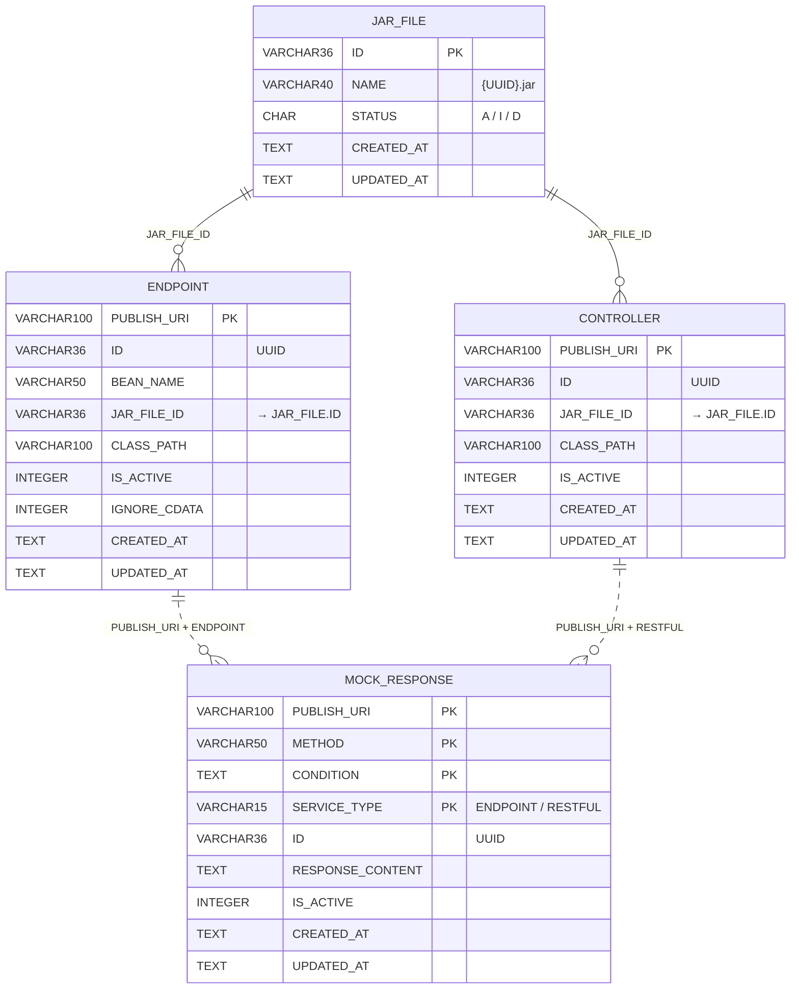

# 4. 資料設計

## 4.1 概念資料模型

所有關聯皆為**邏輯關聯**，資料庫沒有建立外鍵約束；一致性由應用程式維護。圖中與下表的型別以預設的 SQLite 為準；PostgreSQL 的布林欄位為 `BOOLEAN`，見 [PostgreSQL 遷移腳本](#postgresql-遷移腳本)。

## 4.2 資料儲存設計

### 資料表

#### `JAR_FILE`

| 欄位 | 型別 | 約束 | 說明 |
|---|---|---|---|
| `ID` | VARCHAR(36) | PK | JPA `GenerationType.UUID` |
| `NAME` | VARCHAR(40) | NOT NULL | 實體檔名 `{UUID}.jar` |
| `STATUS` | CHAR | NOT NULL | `A` 使用中、`I` 未使用、`D` 已刪除（`JarFileStatusConverter`） |
| `CREATED_AT` / `UPDATED_AT` | TEXT | NOT NULL, DEFAULT CURRENT_TIMESTAMP | |

#### `ENDPOINT`

| 欄位 | 型別 | 約束 | 說明 |
|---|---|---|---|
| `PUBLISH_URI` | VARCHAR(100) | PK | V1.2 由 `PUBLISH_URL` 更名 |
| `ID` | VARCHAR(36) | NOT NULL | UUID，介面用的識別碼；每次儲存都會重新產生 |
| `BEAN_NAME` | VARCHAR(50) | NOT NULL | |
| `JAR_FILE_ID` | VARCHAR(36) | NOT NULL | |
| `CLASS_PATH` | VARCHAR(100) | NOT NULL | |
| `IS_ACTIVE` | INTEGER | NOT NULL, DEFAULT 1 | 應用程式寫入時固定先存 0 |
| `IGNORE_CDATA` | INTEGER | NOT NULL, DEFAULT 0 | V1.2 新增 |

#### `CONTROLLER`

同 `ENDPOINT`，但沒有 `BEAN_NAME` 與 `IGNORE_CDATA`。

#### `MOCK_RESPONSE`

| 欄位 | 型別 | 約束 | 說明 |
|---|---|---|---|
| `PUBLISH_URI` | VARCHAR(100) | PK | V1.2 由 `PUBLISH_URL` 更名 |
| `METHOD` | VARCHAR(50) | PK | |
| `CONDITION` | TEXT | PK | |
| `SERVICE_TYPE` | VARCHAR(15) | PK | `ServiceType` 列舉名稱 |
| `ID` | VARCHAR(36) | NOT NULL | UUID；修改時刪除重建會產生新值 |
| `RESPONSE_CONTENT` | TEXT | 可為 NULL | |
| `IS_ACTIVE` | INTEGER | NOT NULL, DEFAULT 1 | 應用程式寫入時固定先存 0 |

### JPA 對應

| 實體 | `@Id` | 備註 |
|---|---|---|
| `JarFileEntity` | `id` | |
| `EndpointEntity` | `publishUri` | `ID` 欄位對應 `uuId` 屬性 |
| `ControllerEntity` | `publishUri` | 同上 |
| `MockResponseEntity` | `@EmbeddedId MockResponseId` | `ID` 欄位對應 `uuId` |

`BaseEntity` 宣告了 `createdAt`、`updatedAt`，但沒有標註 `@MappedSuperclass`，所以 JPA **不會**對應這兩個欄位：插入時由資料庫預設值填入，之後 `UPDATED_AT` 只有在具名 SQL（例如 Publish URI 連動）中才會被更新（TD-09）。

### 遷移腳本（Flyway）

| 版本 | 檔案 | 內容 |
|---|---|---|
| V1.0 | `V1.0__create_tables.sql` | 建立 `ENDPOINT`、`JAR_FILE`、`MOCK_RESPONSE` |
| V1.1 | `V1.1__create_controller_tables.sql` | 建立 `CONTROLLER` |
| V1.2 | `V1.2__alter_column.sql` | `PUBLISH_URL` → `PUBLISH_URI`；`ENDPOINT` 新增 `IGNORE_CDATA` |

上表是 SQLite 的腳本（`classpath:db.migration`）。新增欄位或資料表時，請新增 `V1.3__xxx.sql`，不要修改已執行過的腳本；SQLite 與 PostgreSQL 兩個位置都要新增相同版本的腳本。SQLite 的 `ALTER TABLE` 能力有限（不支援修改欄位型別、刪除約束），複雜變更需要「建新表 → 搬資料 → 改名」。

### PostgreSQL 遷移腳本 {#postgresql-遷移腳本}

資料庫預設為 SQLite；PostgreSQL 為可選項，由 `data-source*.properties` 的 `app.database.flyway-locations` 選擇腳本位置（設定方式見 [設定參考](../guide/configuration.md#切換到-postgresql可選)）。兩套腳本位置互斥，每種資料庫只執行自己的腳本：

| 資料庫 | Flyway 位置 | 腳本 |
|---|---|---|
| SQLite（預設） | `classpath:db.migration` | `V1.0`～`V1.2`（見上表） |
| PostgreSQL | `classpath:db.postgresql` | `V1.2__create_tables.sql`：一次建立 `ENDPOINT`、`JAR_FILE`、`MOCK_RESPONSE`、`CONTROLLER`，結構等同 SQLite 執行完 V1.0～V1.2 的最終狀態 |

PostgreSQL 腳本從 `V1.2` 起算，讓兩種資料庫的下一版都是 `V1.3`。型別對應：

| 欄位 | SQLite | PostgreSQL | 說明 |
|---|---|---|---|
| `IS_ACTIVE` | INTEGER, DEFAULT 1 | BOOLEAN, DEFAULT TRUE | 對應實體的 `Boolean`；`SQL_SELECT_RESPONSE_CONTENT` 的 `IS_ACTIVE = TRUE` 在兩者皆成立 |
| `IGNORE_CDATA` | INTEGER, DEFAULT 0 | BOOLEAN, DEFAULT FALSE | 同上 |
| `CREATED_AT` / `UPDATED_AT` | TEXT, DEFAULT CURRENT_TIMESTAMP | TEXT, DEFAULT `TO_CHAR(CURRENT_TIMESTAMP, 'YYYY-MM-DD HH24:MI:SS')` | 維持 TEXT，與 SQLite 格式相同（TD-09 未修正） |
| 其他欄位 | VARCHAR／TEXT／CHAR | 相同 | PostgreSQL 會強制 VARCHAR 長度，SQLite 不會 |

識別字不加雙引號，主鍵與 NOT NULL 約束與 SQLite 相同；具名 SQL 與 JPA 查詢都是標準語法，兩種資料庫共用，不需分支。`CONDITION` 為複合主鍵的一部分，PostgreSQL btree 索引單筆上限約 2.7KB，過長的條件字串會無法寫入。

:::warning 尚未實機驗證
PostgreSQL 腳本與設定只經過讀檔核對與 SQLite 回歸測試，尚未在實際 PostgreSQL 環境驗證連線、建表與 Mock 命中。
:::

### 具名 SQL

`resources/sql/` 中的檔案由本專案的 `jdbc/NamedSqlLoader` 依名稱以 UTF-8 讀取 `classpath:sql/{名稱}.sql`，結果是不可變字串並以 `ConcurrentHashMap` 快取，缺檔時丟出含檔名的例外。唯一的例外是執行期 Mock 查詢的 `MockResponseDao`（與 `base-jar` 同步的相容類別），仍透過 zipe 的 `ResourceEnum.SQL` 讀取，且固定使用 `SQL_SELECT_RESPONSE_CONTENT`（見 [Mock 回應引擎](mock-engine.md)）。

| 檔案 | 用途 |
|---|---|
| `SQL_SELECT_ENDPOINT_RELATED_JAR_FILE` | Endpoint 清單／單筆（含 JAR 名稱、狀態）。`${CONDITIONS}` 由 `EndPointJDBC` 自行替換：清單換成空字串；單筆依 id、publishUri 是否有值加上 `AND e.ID = :id`、`AND e.PUBLISH_URI = :publishUri`，以具名參數綁值 |
| `SQL_SELECT_CONTROLLER_RELATED_JAR_FILE` | Controller 清單／單筆，`${CONDITIONS}` 由 `ControllerJDBC` 以相同方式替換 |
| `SQL_SELECT_RESPONSE_CONTENT` | 執行期 Mock 查詢 |
| `SQL_UPDATE_PUBLISH_URI_FOR_RESPONSE` | Publish URI 連動（`CommonServiceImpl` 以 `NamedSqlLoader` 取得後交給 `BaseJDBCAdapter.update(String, Map)`） |
| `SQL_DEL_RESPONSE` | 依 `ID` 刪除回應（同上） |
| `SQL_UPDATE_RESPONSE` | 依 `ID` 更新回應（目前未使用） |

## 4.3 資料一致性策略

| 情境 | 策略 | 風險 |
|---|---|---|
| DB 與 JAR 檔案 | 先寫檔再寫 DB（上傳）；先改狀態再刪檔（刪除） | 上傳時 DB 失敗會留下孤兒檔案；無清理排程 |
| DB 與 JVM 執行狀態 | 啟用：先載入成功才寫 `IS_ACTIVE=1`；停用：先撤銷再寫 0 | 載入成功但寫 DB 失敗時，服務已發布但 DB 顯示停用 |
| 啟動時重建 | 以 DB 為準重建 JVM 狀態，失敗者寫回停用 | — |
| 交易 | 服務層方法標註 `@Transactional`；Controller 層的多步驟編排（如 update）**不在同一交易** | 編輯流程中途失敗可能留下部分變更 |
| 並發 | 無樂觀鎖；ClassLoader 登錄表以 `synchronized` 保護。管理端的具名 SQL 由 `NamedSqlLoader` 讀取，不經過 JVM 共用的 `ResourceEnum.SQL`，Endpoint 與 Controller 清單查詢可以安全並行（修正 issue #19：換頁時兩支清單 API 同時查詢，曾互相讀到對方的 SQL，造成側欄數量與清單不一致） | 兩人同時操作同一服務時結果不可預期；使用者自訂 JAR 若自行呼叫 `ResourceEnum.SQL.getResource(...)`，仍可能與執行期 Mock 查詢互相干擾（見 [Mock 回應引擎](mock-engine.md)） |
| 刪除服務 | 不刪 Mock 回應 | 殘留資料；同 URI 重建時沿用 |
