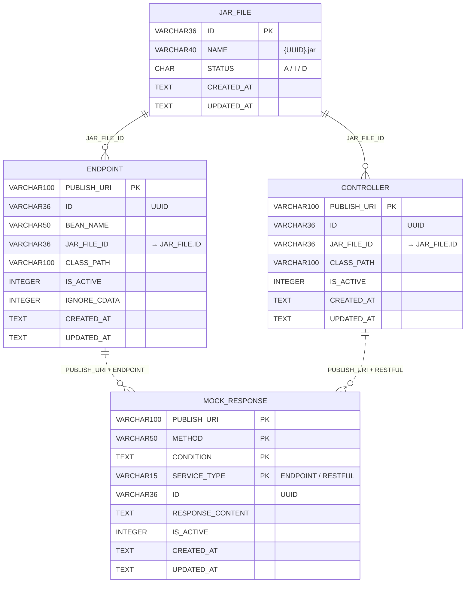

# 4. 資料設計

## 4.1 概念資料模型

所有關聯皆為**邏輯關聯**，資料庫沒有建立外鍵約束；一致性由應用程式維護。

## 4.2 資料儲存設計

### 資料表

#### `JAR_FILE`

| 欄位 | 型別 | 約束 | 說明 |
|---|---|---|---|
| `ID` | VARCHAR(36) | PK | JPA `GenerationType.UUID` |
| `NAME` | VARCHAR(40) | NOT NULL | 實體檔名 `{UUID}.jar` |
| `STATUS` | CHAR | NOT NULL | `A` 使用中、`I` 未使用、`D` 已刪除（`JarFileStatusConverter`） |
| `CREATED_AT` / `UPDATED_AT` | TEXT | NOT NULL, DEFAULT CURRENT_TIMESTAMP | |

#### `ENDPOINT`

| 欄位 | 型別 | 約束 | 說明 |
|---|---|---|---|
| `PUBLISH_URI` | VARCHAR(100) | PK | V1.2 由 `PUBLISH_URL` 更名 |
| `ID` | VARCHAR(36) | NOT NULL | UUID，介面用的識別碼；每次儲存都會重新產生 |
| `BEAN_NAME` | VARCHAR(50) | NOT NULL | |
| `JAR_FILE_ID` | VARCHAR(36) | NOT NULL | |
| `CLASS_PATH` | VARCHAR(100) | NOT NULL | |
| `IS_ACTIVE` | INTEGER | NOT NULL, DEFAULT 1 | 應用程式寫入時固定先存 0 |
| `IGNORE_CDATA` | INTEGER | NOT NULL, DEFAULT 0 | V1.2 新增 |

#### `CONTROLLER`

同 `ENDPOINT`，但沒有 `BEAN_NAME` 與 `IGNORE_CDATA`。

#### `MOCK_RESPONSE`

| 欄位 | 型別 | 約束 | 說明 |
|---|---|---|---|
| `PUBLISH_URI` | VARCHAR(100) | PK | V1.2 由 `PUBLISH_URL` 更名 |
| `METHOD` | VARCHAR(50) | PK | |
| `CONDITION` | TEXT | PK | |
| `SERVICE_TYPE` | VARCHAR(15) | PK | `ServiceType` 列舉名稱 |
| `ID` | VARCHAR(36) | NOT NULL | UUID；修改時刪除重建會產生新值 |
| `RESPONSE_CONTENT` | TEXT | 可為 NULL | |
| `IS_ACTIVE` | INTEGER | NOT NULL, DEFAULT 1 | 應用程式寫入時固定先存 0 |

### JPA 對應

| 實體 | `@Id` | 備註 |
|---|---|---|
| `JarFileEntity` | `id` | |
| `EndpointEntity` | `publishUri` | `ID` 欄位對應 `uuId` 屬性 |
| `ControllerEntity` | `publishUri` | 同上 |
| `MockResponseEntity` | `@EmbeddedId MockResponseId` | `ID` 欄位對應 `uuId` |

`BaseEntity` 宣告了 `createdAt`、`updatedAt`，但沒有標註 `@MappedSuperclass`，所以 JPA **不會**對應這兩個欄位：插入時由資料庫預設值填入，之後 `UPDATED_AT` 只有在具名 SQL（例如 Publish URI 連動）中才會被更新（TD-09）。

### 遷移腳本（Flyway）

| 版本 | 檔案 | 內容 |
|---|---|---|
| V1.0 | `V1.0__create_tables.sql` | 建立 `ENDPOINT`、`JAR_FILE`、`MOCK_RESPONSE` |
| V1.1 | `V1.1__create_controller_tables.sql` | 建立 `CONTROLLER` |
| V1.2 | `V1.2__alter_column.sql` | `PUBLISH_URL` → `PUBLISH_URI`；`ENDPOINT` 新增 `IGNORE_CDATA` |

新增欄位或資料表時，請新增 `V1.3__xxx.sql`，不要修改已執行過的腳本。SQLite 的 `ALTER TABLE` 能力有限（不支援修改欄位型別、刪除約束），複雜變更需要「建新表 → 搬資料 → 改名」。

### 具名 SQL

`resources/sql/` 中的檔案透過 `ResourceEnum.SQL.getResource(名稱)` 取得：

| 檔案 | 用途 |
|---|---|
| `SQL_SELECT_ENDPOINT_RELATED_JAR_FILE` | Endpoint 清單／單筆（含 JAR 名稱、狀態），`${CONDITIONS}` 由 `Conditions` 動態組合 |
| `SQL_SELECT_CONTROLLER_RELATED_JAR_FILE` | Controller 清單／單筆 |
| `SQL_SELECT_RESPONSE_CONTENT` | 執行期 Mock 查詢 |
| `SQL_UPDATE_PUBLISH_URI_FOR_RESPONSE` | Publish URI 連動 |
| `SQL_DEL_RESPONSE` | 依 `ID` 刪除回應 |
| `SQL_UPDATE_RESPONSE` | 依 `ID` 更新回應（目前未使用） |

## 4.3 資料一致性策略

| 情境 | 策略 | 風險 |
|---|---|---|
| DB 與 JAR 檔案 | 先寫檔再寫 DB（上傳）；先改狀態再刪檔（刪除） | 上傳時 DB 失敗會留下孤兒檔案；無清理排程 |
| DB 與 JVM 執行狀態 | 啟用：先載入成功才寫 `IS_ACTIVE=1`；停用：先撤銷再寫 0 | 載入成功但寫 DB 失敗時，服務已發布但 DB 顯示停用 |
| 啟動時重建 | 以 DB 為準重建 JVM 狀態，失敗者寫回停用 | — |
| 交易 | 服務層方法標註 `@Transactional`；Controller 層的多步驟編排（如 update）**不在同一交易** | 編輯流程中途失敗可能留下部分變更 |
| 並發 | 無樂觀鎖；ClassLoader 登錄表以 `synchronized` 保護 | 兩人同時操作同一服務時結果不可預期 |
| 刪除服務 | 不刪 Mock 回應 | 殘留資料；同 URI 重建時沿用 |
