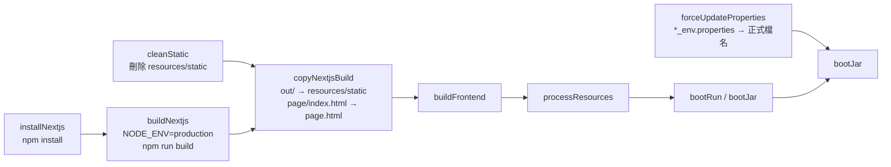

# 8. 部署、設定與運維

## 8.1 建置流程

`backend/build.gradle` 把前端建置串進 `processResources`：



| 任務 | 說明 |
|---|---|
| `installNextjs`、`buildNextjs` | 使用 `tools/node-v22.20.0-win-x64/npm.cmd`，把該目錄加到 `PATH` |
| `copyNextjsBuild` | 複製後把 `endpoint`、`restful`、`response`、`test-api`、`about` 的 `index.html` 另存為 `{page}.html` |
| `forceUpdateProperties` | 依 `-Penv`（預設 `dev`）把 `resources_{env}.properties`、`data-source_{env}.properties` 寫到 `build/resources/main/` 的正式檔名，並刪除其他環境檔 |
| `bootJar` | `duplicatesStrategy = INCLUDE` |

目前 `installNextjs` 與 `buildNextjs` 是未宣告輸入與輸出的 `Exec` 任務，每次進入此任務鏈都會再次執行，不會因為前端原始碼未變更而略過。`cleanStatic` 也會刪除既有靜態資源，再由 `copyNextjsBuild` 複製。此流程同樣影響需要 `processResources` 的 `build` 與 `test`。僅開發或測試後端時可加上 `-x buildFrontend`，但內嵌前端不會更新；詳見 [建置緩慢排查](../guide/troubleshooting.md#vs-code-或-gradle-建置緩慢)。

### 部署步驟

VS Code 另提供 **Dynamic API：前端**（`node-terminal`）與 **Dynamic API：前後端**（compound）啟動設定。前端固定使用 port 3000，啟動環境傳入本機後端網址；依賴安裝為獨立 task，不會在每次 F5 重跑。操作方式見 [安裝與啟動](../guide/installation.md#從-vs-code-啟動前端或前後端)。

本機也可透過 `.vscode/launch.json` 的 **Dynamic API：後端** 直接啟動 `com.dynamicapi.Application`；這條路徑由 Java 擴充套件處理，不會觸發 Gradle 前端建置或 `bootJar` 的環境設定覆寫。JDK 路徑與操作步驟見 [安裝與啟動](../guide/installation.md#vs-code-執行與偵錯後端)。

```powershell
cd backend
.\gradlew.bat clean bootJar -Penv=pro
# 產物：build\libs\backend-0.0.1-SNAPSHOT.jar
```

在目標主機：

1. 安裝 JDK 17 以上。
2. 建立 SQLite、JAR、日誌所需目錄（依 properties）。
3. `java -jar backend-0.0.1-SNAPSHOT.jar`
4. 開啟 `http://{host}:8080/dynamic-api/`。

升級時直接替換 JAR 並重啟；資料庫由 Flyway 自動遷移，已啟用的服務自動恢復。

目前沒有 CI/CD 設定。

### Docker Compose

`backend/Dockerfile` 採單階段封裝，需先在主機產生 `build/libs/backend-0.0.1-SNAPSHOT.jar`：

```powershell
cd backend
.\gradlew.bat clean bootJar -Penv=pro
docker compose up --build -d
```

非 Windows 主機的 Gradle 前端任務無法執行，建立 JAR 時須加 `-x buildFrontend`。除非先手動建置前端並複製到 `backend/src/main/resources/static/`，否則該 JAR 不含最新的管理介面；容器本身不負責建置前端。

Compose 透過接在 `java -jar` 後的命令列參數覆寫下列路徑。命令列屬性的優先序高於 `db-spring-boot-starter` 以 `@PropertySource` 載入的預設資料來源設定：

| 用途 | 設定鍵與容器路徑 | 具名 volume |
|---|---|---|
| SQLite | `dynamic.data-source-map[webservice].url=jdbc:sqlite:/data/sqlite/webservice.db` | `sqlite-data` → `/data/sqlite` |
| 上傳 JAR | `jar.file.dir=/data/jars/` | `uploaded-jars` → `/data/jars` |
| 日誌 | `log.base=/data/logs` | `application-logs` → `/data/logs` |

Dockerfile 在應用啟動前建立三個掛載點。`docker compose down` 不會刪除具名 volume；`docker compose down -v` 會永久刪除資料庫、上傳 JAR 與日誌，清理前須先備份 SQLite 與 JAR volume。升級或回滾映像時保留原 volume，回滾前先備份資料庫，避免新版 Flyway 遷移後的資料庫與舊版程式不相容。

系統未提供認證，只能部署在受信任的內部網路。Compose 尚未配置健康檢查；啟動後應呼叫 `GET /dynamic-api/ws/getEndpoints` 驗證應用與資料庫，不可只以容器程序仍在執行判定服務健康。

## 8.2 組態管理

| 類別 | 位置 | 說明 |
|---|---|---|
| 應用設定 | `application.yml` | 打包在 JAR 內；可用 `--server.port=9090` 等命令列參數或外部 `application.yml` 覆寫 |
| 環境差異 | `resources_{env}.properties`、`data-source_{env}.properties` | 建置時決定 |
| 前端 | `.env.development`、`.env.production`、`.env.local` | 建置時嵌入 |

各設定鍵說明見 [使用者指南：設定參考](../guide/configuration.md)。

:::tip 執行期覆寫路徑
`jar.file.dir`、`log.base` 等屬性可用命令列覆寫，不必重新建置：

```bash
java -jar backend-0.0.1-SNAPSHOT.jar --jar.file.dir=/opt/dam/jars/ --log.base=/var/log/dam
```

資料來源設定由 `db-spring-boot-starter` 透過 `@PropertySource` 讀取 `data-source.properties`，再以 `@ConfigurationProperties(prefix = "dynamic")` 綁定。Spring Boot 命令列屬性的優先序較高，因此使用完整鍵 `--dynamic.data-source-map[webservice].url=...` 可以覆寫打包值；Docker Compose 即採用此方式。
:::

## 8.3 監控與紀錄

| 項目 | 說明 |
|---|---|
| 日誌 | `logback-spring.xml`：`{log.base}/{moduleName}.log`（全部）、`_err.log`（錯誤）、`_print.log`；依日期與大小輪替，封存於 `{log.base}/archive/` |
| 即時日誌 | `GET /common/logs/stream`（SSE） |
| 健康檢查 | 引入了 Actuator，但 `exposure.include` 只列出 `custom-api-mappings`，`/actuator/health` 預設不對外開放。可改為 `health,show-mappings` |
| 指標 | 未設定 |
| 關鍵日誌訊息 | `Web Service 註冊服務:{bean}, 對應 URI:{uri}`（成功）、`… 註冊服務 … 失敗`、`Controller 註冊服務:{uri}, 失敗` |

## 8.4 備份與還原

| 對象 | 方式 |
|---|---|
| SQLite 檔 | 停機時直接複製；線上可用 `sqlite3 db ".backup file"` |
| JAR 目錄 | 複製整個 `jar.file.dir` |
| 日誌目錄 | 依保存需求複製整個 `log.base`；還原服務本身不依賴日誌 |

SQLite 與 JAR 目錄需要**同時**備份，否則 `JAR_FILE` 記錄與實體檔案可能對不上。
