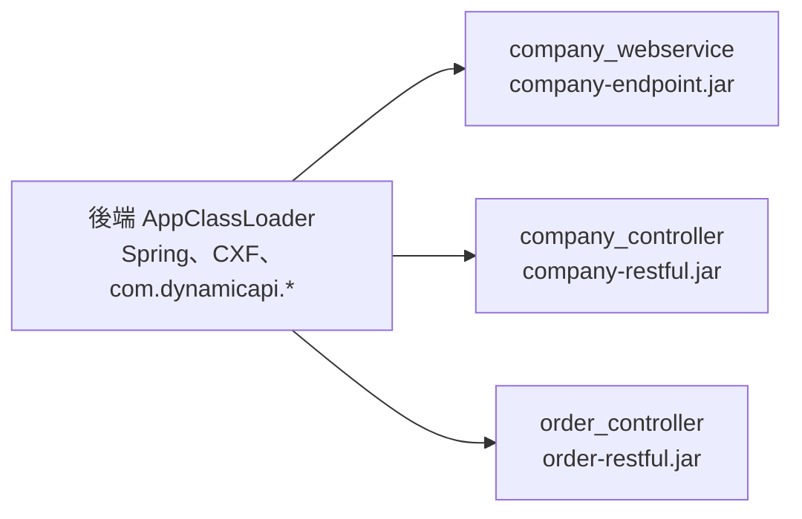
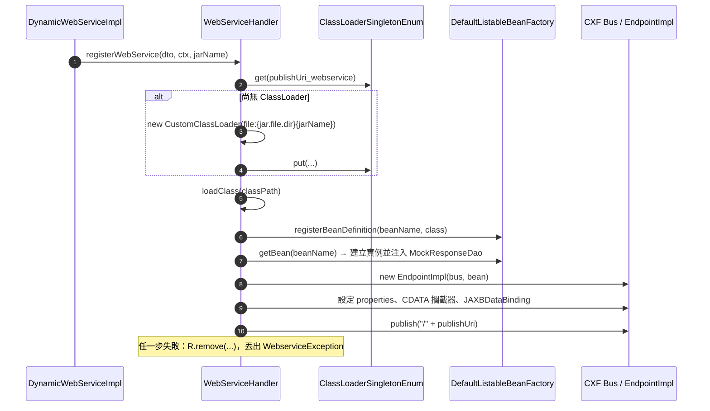
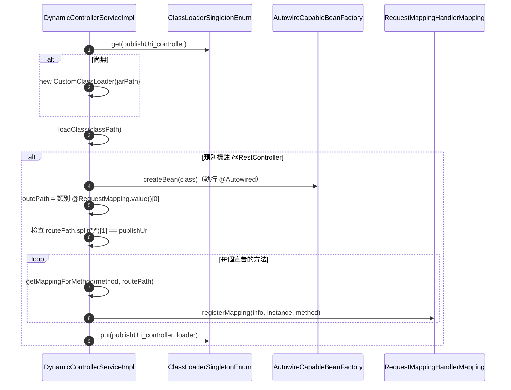
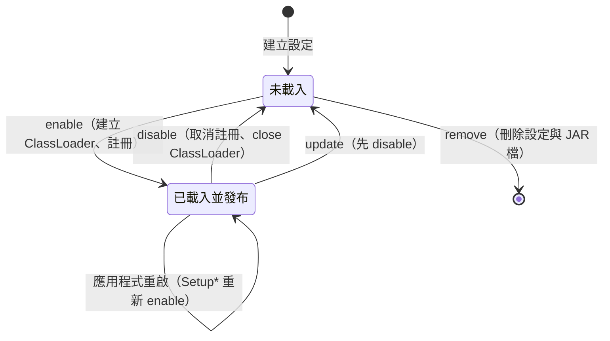

# 3.2 動態載入設計

動態載入是本系統的核心：在不重啟 JVM 的情況下，把使用者 JAR 中的類別變成可呼叫的 SOAP 或 REST 服務，並能撤銷。

## ClassLoader 設計

### `CustomClassLoader`（zipe base starter）

```java
public class CustomClassLoader extends URLClassLoader {
    @Override
    public Class<?> loadClass(String name) throws ClassNotFoundException {
        try {
            return super.loadClass(name);   // 標準委派：先父載入器
        } catch (ClassNotFoundException e) {
            return findClass(name);         // 父載入器找不到才從 JAR 找
        }
    }
    public void unloadJarFile(URL jarUrl) { /* 開啟再關閉對應 JarFile */ }
}
```

- **父載入器**為後端應用的 ClassLoader（`this.getClass().getClassLoader()`）。
- 採**父優先**：使用者 JAR 無法覆寫後端已有的類別，也確保 `RestfulBase`、`MockResponseDao` 等型別與後端一致（同一個 `Class` 物件），注入才會成功。
- 關閉時呼叫 `URLClassLoader.close()` 釋放 JAR 檔案控制代碼，讓 Windows 上的 JAR 可以被刪除。

### `ClassLoaderSingletonEnum`

全域的 ClassLoader 登錄表（`Collections.synchronizedMap`），鍵值格式：

| 服務類型 | 鍵 |
|---|---|
| Endpoint | `{publishUri}_webservice` |
| RESTful | `{publishUri}_controller` |

同一 Publish URI 的 SOAP 與 REST 各自擁有 ClassLoader，互不干擾。



## Endpoint（SOAP）發布

`WebServiceHandler.registerWebService(endpointDTO, context, fileName)`：



CXF 設定細節：

| 設定 | 值 | 目的 |
|---|---|---|
| `set-jaxb-validation-event-handler` | `false` | 對未知元素寬容 |
| `disable.output.escaping` | `true` | 輸出不額外跳脫 |
| `JAXBDataBinding.unwrapJAXBElement` | `true` | 直接取得內容物件 |
| `JAXBDataBinding.mtomEnabled` | `true` | 支援 MTOM |
| `JAXBDataBinding.namespaceMap` | `"" → http://www.w3.org/2001/XMLSchema` | 處理空命名空間 |
| `ignoreCdata=true` 時 | In：`CdataContentInterceptor`；Out：`ResponseCdataInterceptor` | 見 [SRS FR-EP-008](../srs/functional/endpoint.md#fr-ep-008-cdata-處理) |

發布位址為相對路徑，由 CXF Servlet（`web.service.uri-mapping: /webservice/*`）接手，所以完整位址是 `/dynamic-api/webservice/{publishUri}`。

**撤銷**（`removeWebService`）：從 `ServerRegistry` 找出位址以 `publishUri` 結尾的 Server → `stop()`、`destroy()` → 若 JAR 檔存在則 `unloadJarFile` → `close()` ClassLoader → 從登錄表移除。

:::note
撤銷時沒有移除 Spring 中的 Bean Definition。下次啟用會以同名重新註冊並覆蓋（依賴 `spring.main.allow-bean-definition-overriding=true`）。
:::

## RESTful 動態註冊

`DynamicControllerServiceImpl.startUpControllerProcess(publishUri, classPath, jarPath)`：



`getMappingForMethod` 支援的註解與轉換：

| 註解 | 建立的 `RequestMappingInfo` |
|---|---|
| `@RequestMapping` | `paths`、`methods`、`params`、`headers`、`consumes`、`produces` 全部帶入 |
| `@GetMapping` / `@PostMapping` / `@PutMapping` / `@DeleteMapping` | 只帶入 `paths` 與對應 HTTP 方法 |
| 其他（含 `@PatchMapping`） | 不註冊 |

路徑組合為 `classPath + methodPath` 的字串串接；方法沒有指定路徑時使用類別路徑。

**撤銷**（`disabledController`）：以相同規則重新計算每個方法的 `RequestMappingInfo` 並 `unregisterMapping` → 從登錄表移除 → `unloadJarFile` → `close()`。

:::caution 設計注意
1. 註冊時若在中途失敗（例如第三個方法的對應與既有路由衝突），先前已註冊的對應不會回收，ClassLoader 也不會放入登錄表，之後停用無法清除那些對應（TD-05）。
2. 類別沒有 `@RestController` 時方法直接結束，不報錯，但服務仍被標記為啟用。
:::

## 生命週期總覽



## 類別卸載與記憶體

`close()` 之後，只要沒有其他物件持有該 ClassLoader 載入的類別或實例，GC 便能回收其 Metaspace。可能阻止回收的來源：

- Spring 中殘留的 Bean Definition／單例（Endpoint）。
- CXF 內部快取的 JAXB Context。
- 使用者程式碼啟動的執行緒、`ThreadLocal`、靜態快取。

頻繁地更換 JAR 並重新啟用，長時間下可能造成 Metaspace 成長；重啟後端即可完全釋放。
