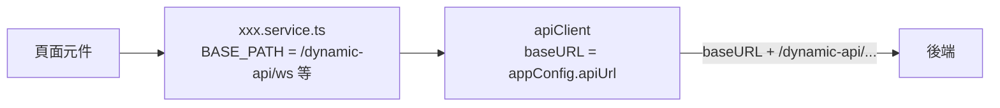

# 3.4 管理介面（Next.js）

## 結構

`nextjs-dynamic-api-manager/src/`：

| 目錄 | 內容 |
|---|---|
| `app/` | App Router 頁面：`page.tsx`（首頁，導向 `/endpoint`）、`endpoint/`、`restful/`、`response/`、`wsdl/`、`about/`、`test-api/`、`layout.tsx`（經 `Providers` 套主題並包上 `AppShell`）、`not-found.tsx` |
| `components/` | `Providers`（明亮版主題、`CssBaseline`、`ServiceSummaryProvider`、`ToastProvider`、`ConfirmProvider`）；`shell/`（`AppShell`、`Sidebar`、`Topbar`、`navigation.ts`：側欄項目與麵包屑規則）；`feedback/`（`ToastProvider`、`ConfirmProvider`、`DataState` 的載入中／無資料／錯誤元件）；`service-list/`（Endpoint 與 RESTful 共用的頁首、統計卡、狀態篩選、批次操作列、分頁列、啟停與刪除流程 `useServiceActions`、Mock 筆數查詢 `useMockCounts`）；`response/ResponseEditorPanel`（Mock 回應右側編輯面板）；`StatusSwitch`、`StatusBadge`、`ServiceSummaryProvider`。`CyberpunkBackground`、`CyberpunkLoader` 未使用 |
| `forms/` | `EndpointForm`、`RestfulForm`（react-hook-form + yup） |
| `dialogs/` | 目前沒有檔案；WSDL 轉換已改為 `/wsdl` 頁 |
| `services/` | `api.ts`（axios 實例）、`endpoint.service.ts`、`restful.service.ts`、`response.service.ts` |
| `types/` | `models.ts`、`response.ts` |
| `config/` | `config.ts`（環境設定） |
| `theme/` | `tokens.ts`（`design/admin-light-redesign/tokens.json` 的色碼與尺寸）、`light.ts`（`createTheme`，`palette.mode: 'light'`）；`cyberpunk.ts` 未使用 |
| `utils/` | `serviceUrl.ts`（以 `window.location` 組呼叫位址與頂列主機，不使用 `appConfig.apiUrl`）、`formatContent.ts`（JSON／XML 格式化） |

## 外框與共用互動

| 項目 | 實作 |
|---|---|
| 主題 | `theme/light.ts`：主色 `#2563eb`、頁面底色 `#f5f7fa`、按鈕文字不轉大寫。字型 `Inter, 'Noto Sans TC', system-ui, sans-serif`，等寬 `'JetBrains Mono', monospace`；不載入外部字型，未安裝時退回系統字型 |
| 側欄 | 寬 232。分組「服務」：SOAP Endpoint、RESTful API、Mock 回應；「工具」：WSDL 轉換、系統資訊（`/about`）。目前頁帶 `aria-current="page"`。`/test-api` 不在側欄，但網址保留。SOAP Endpoint／RESTful API 右側數字是 `getEndpoints`、`getControllers` 的實際筆數 |
| 頂列 | 高 56。左側麵包屑（例如 `SOAP Endpoint / company / Mock 回應`，上層清單可點）；右側連線狀態：`ServiceSummaryProvider` 在載入、換頁與操作後並行呼叫 `getEndpoints`、`getControllers`，兩者都成功顯示「後端連線正常」，任一失敗顯示「後端連線異常」與「重新檢查」。顯示的主機一律取目前瀏覽器網址（`window.location.host`），即使 `NEXT_PUBLIC_API_URL` 指向不同來源也一樣；連線狀態仍依實際 API 成敗判斷（後端沒有健康檢查端點） |
| 窄螢幕 | 寬度小於 900 時側欄換到內容上方；寬表格只在自己的容器內橫向捲動 |
| 確認框 | `useConfirm()`，取代 `window.confirm`；刪除類為紅色按鈕、預設焦點在「取消」 |
| toast | `useToast()`，右下角、同時一則；啟停成功附「復原」（反向呼叫一次），刪除與批次操作不提供復原；錯誤 toast 不自動關閉 |
| 資料狀態 | 清單頁都有載入中、無資料、搜尋無結果與載入失敗（含「重新載入」） |

所有頁面皆為 Client Component（`'use client'`），資料在瀏覽器端以 axios 取得。

## API 呼叫設計

`appConfig.apiUrl` 的決定邏輯（`config/config.ts`）：

| 情況 | `apiUrl` | 實際請求 |
|---|---|---|
| 瀏覽器網址**不含** `:3000`（生產模式） | `''` | `/dynamic-api/ws/...`（同源相對路徑） |
| 瀏覽器網址含 `:3000`（開發模式） | `NEXT_PUBLIC_API_URL` | `${NEXT_PUBLIC_API_URL}/dynamic-api/ws/...` |

`apiClient` 的回應攔截器：若 `response.data.code` 是數字且不等於 200，丟出 `Error(message)`；HTTP 錯誤時取 `error.response.data.message` 或 `statusText`。

:::warning 開發模式代理（KI-01）
`.env.development` 的 `NEXT_PUBLIC_API_URL=http://localhost:3000/api` 原本搭配 `src/app/api/dynamic-api/[...path]/route.ts` 將請求轉送到 `BACKEND_API_URL`。該路由已刪除，需改用 `NEXT_PUBLIC_API_URL=http://localhost:8080` 直連後端（CORS 已允許）。
:::

## 頁面流程

| 頁面 | 載入 | 操作 |
|---|---|---|
| Endpoint | `getEndpoints`；再對每個服務呼叫 `getResponseList` 取 Mock 回應筆數（同時最多 4 筆，單筆失敗顯示「—」） | 新增／編輯（`EndpointForm` 對話框）：若有選檔先 `uploadJarFile` 取得 `jarFileId`，再 `saveWebService` / `updateWebService`；開關：確認後 `switchWebService`；批次啟停：依序逐筆 `switchWebService` 並彙總成功與失敗筆數；刪除（單筆或批次）：確認後 `removeWebService`；發布名稱與「N 筆 ›」連到 `/response?publishUri=&serviceType=ENDPOINT` |
| RESTful | `getControllers` | 新增／編輯（`RestfulForm` 對話框）、開關（`switchController`）、刪除與批次刪除（`removeController`），同樣經確認框與 toast；不提供批次啟停 |
| Response | 讀取 query string；有 `publishUri` 才 `getResponseList`，沒有時顯示「請先選擇服務」引導 | 右側編輯面板（寬 1200 以上與表格並排，以下以抽屜覆蓋）：新增 `saveMockResponse`、編輯 `updateResponse`、刪除（確認後）`deleteResponse`；表格每列開關：確認後 `switchResponse`。方法名稱必填；「格式化」只處理 JSON／XML，只調整結構之間的空白與縮排：JSON 不經過數值轉換，數字字面值（例如 `9007199254740993`、`1.10`）逐字保留；XML 的 CDATA、註解、處理指令、屬性值與文字原樣保留，含文字的元素整段不動；無效內容或無法安全處理的結構（DOCTYPE 內部子集、`xml:space`）不改內容並提示。儲存請求進行中鎖定面板（欄位唯讀，Esc、關閉、取消、點其他列與「新增回應」都不作用），並以開啟序號比對，回應只關閉送出它的那次編輯，離開頁面時序號也會失效，離頁後才回來的舊回應不影響回到頁面後新開的表單；失敗時面板保留原輸入與錯誤，可直接再送。資訊卡的呼叫位址以 `window.location.origin` 組成 |
| WSDL 轉換（`/wsdl`） | — | `genWsdlObj`：自組 multipart，網址模式送 `wsdlUrl`、檔案模式送 `file`、有填才送 `packageName`；以 `responseType: 'blob'` 與 `validateStatus` 自行判斷，HTTP 200、有內容且媒體類型不是 text 或 JSON 才算成功（後端以 200 回傳的純文字或 JSON 錯誤也視為失敗），204、非 2xx 與網路錯誤都顯示「無法轉換」並保留輸入（網址或所選檔案，以及 Package 名稱）。轉換中鎖定來源類型、網址、檔案區與 Package 名稱，並以請求序號作廢過期回應，完成卡與下載只對應送出當下的輸入。成功後以 `<a download>` 下載 `generated_wsdl_object.zip` |

搜尋、狀態篩選與分頁皆在前端對已載入的清單處理。後端沒有各服務 Mock 筆數與批次啟停的端點，因此以既有 API 組合；`switchResponse` 會吞掉後端例外並回成功，所以回應啟停只有網路或 HTTP 錯誤會顯示失敗。

## 建置與整合

| 模式 | 設定（`next.config.ts`） | 輸出 |
|---|---|---|
| 開發（`npm run dev`） | 無 `basePath`、無 `trailingSlash` | Next.js 開發伺服器 :3000 |
| 生產（`NODE_ENV=production npm run build`） | `output: 'export'`、`basePath: '/dynamic-api'`、`trailingSlash: true`、`images.unoptimized` | 靜態檔案於 `out/` |
| E2E（`DYNAMIC_API_E2E=1`，由 Playwright 自動帶入） | 同生產，但**不做** `output: 'export'`；`basePath`、`trailingSlash` 不變 | `.next/`，以 `next start` 在 `127.0.0.1:3100` 提供 |

生產建置由 Gradle 觸發，輸出複製到 `backend/src/main/resources/static/`，並把 `endpoint/index.html` 等複製為 `endpoint.html` 供 `SpaController` 讀取；`SpaController` 找不到 `{page}.html` 時會改讀 `{page}/index.html`（見 [8. 部署](./deployment.md)）。

:::note 兩份 next.config
專案同時存在 `next.config.ts` 與 `next.config.js`，內容相近。Next.js 會優先使用其中一份（依版本規則），維護時請兩份同步或刪除其中一份（TD-10）。`DYNAMIC_API_E2E` 開關兩份都有實作。
:::

## E2E 測試（Playwright）

| 項目 | 內容 |
|---|---|
| 執行 | `cd nextjs-dynamic-api-manager && npm exec playwright install chromium`（第一次；Linux 可能需加 `--with-deps`），之後 `npm run test:e2e` |
| 設定 | `playwright.config.ts`：只有 chromium；`webServer` 以 `DYNAMIC_API_E2E=1` 執行 `npm run build && npm run start -- --hostname 127.0.0.1 --port 3100`，`reuseExistingServer: false`；`baseURL` 為 `http://127.0.0.1:3100/dynamic-api/`。`webServer` 另設 `NEXT_PUBLIC_API_URL=http://127.0.0.1:3100`，只在頁面從含 `:3000` 的網址開啟時生效，供 `e2e/origin.spec.ts` 區分 API 來源與瀏覽器網址 |
| 目錄 | `e2e/pages.spec.ts`（首頁、Endpoint、RESTful、Mock 回應的開啟與列表）、`e2e/restful-form.spec.ts`（RESTful 新增表單成功與驗證失敗）、`e2e/shell.spec.ts`（側欄、麵包屑、連線狀態、窄螢幕）、`e2e/endpoint.spec.ts`（統計、搜尋、篩選、分頁、資料狀態、啟停與復原、批次、刪除確認）、`e2e/response.spec.ts`（資訊卡、呼叫位址、編輯面板、驗證、格式化、儲存失敗、儲存進行中的鎖定、刪除、啟停）、`e2e/wsdl.spec.ts`（來源互斥、驗證、`wsdlUrl` multipart、下載、網址與檔案兩種模式的 204／500／網路錯誤、轉換中鎖定輸入）、`e2e/origin.spec.ts`（以 `http://localhost:3000` 開頁、API 送往 `127.0.0.1:3100`，確認頂列主機、呼叫位址與剪貼簿都用瀏覽器網址）、`e2e/restful.spec.ts`（樣式一致與啟停、刪除）、`e2e/fixtures/`（假資料、攔截夾具與共用輔助函式）。各規格以 `page.on('dialog')` 確認沒有瀏覽器原生對話框 |
| 隔離 | `e2e/fixtures/mock-api.ts` 是自動套用的夾具，在任何 `page.goto` 前以 `page.route` 註冊：`/dynamic-api/ws`、`/dynamic-api/api`、`/dynamic-api/common` 一律回傳固定的 `{code, message, data}`，未定義的 API 回 `code=500` 且不轉送；個別測試可用 `mockApi.set` 改為自訂 HTTP 狀態、純文字或二進位本文、延遲或中斷連線，並由 `calls` 核對查詢字串與 multipart 原文；API 回應帶 `Access-Control-Allow-Origin` 並直接回覆 CORS 預檢，供跨來源測試使用；非 `127.0.0.1:3100` 的請求一律中止（`origin.spec.ts` 另把 `localhost:3000` 的頁面請求轉給測試伺服器）。測試不會連到真的後端或外部網站 |
| 輸出 | `test-results/`（每個測試的 PNG 截圖、失敗時保留的 trace）、`playwright-report/`（HTML 報告），兩者都不進版控、不受 ESLint 檢查 |

固定埠不用 3000：`config/config.ts` 在網址含 `:3000` 時改用 `NEXT_PUBLIC_API_URL`，API 就不會走同源路徑而無法攔截。

:::warning 與出貨形式的差異
正式出貨是靜態匯出（`out/`）由 Spring Boot 提供；E2E 為了能用 `next start` 啟動，跑的是非靜態匯出版本（`.next/`），路由與 `basePath` 相同，但伺服器行為略有差異。E2E 建置不會產生或改動 `out/`。
:::

:::note 表單驗證的實際行為
- `RestfulForm`：`form` 帶 `noValidate`，關閉瀏覽器原生提示，改由 yup 驗證並在欄位下方顯示錯誤；兩個欄位仍保留 `required`（顯示必填星號）。發布名稱（`publishUri`）規則為 `trim()` 後必填，空白或只有空白字元時顯示「請輸入發布路徑」且不送出 API，送出的值會去掉頭尾空白；Class 路徑空白時顯示「Class 路徑為必填」。新增與編輯共用同一套規則。
- `EndpointForm`：必填欄位帶原生 `required` 且 `form` 沒有 `noValidate`，空白送出時由瀏覽器原生提示先擋下，yup 的錯誤文字（「發布名稱為必填」）不會出現。

`e2e/restful-form.spec.ts` 以真實點擊「新增」驗證：發布名稱完全空白、只有空白字元、Class 路徑空白時，以欄位的無障礙說明文字與 `aria-invalid="true"` 斷言錯誤，並確認新增與上傳 API 呼叫次數為 0；補上有效值後錯誤消失；頭尾帶空白的有效值送出時已去掉空白。
:::
