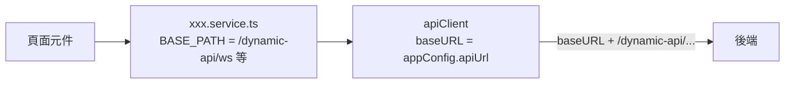

# 3.4 管理介面（Next.js）

## 結構

`nextjs-dynamic-api-manager/src/`：

| 目錄 | 內容 |
|---|---|
| `app/` | App Router 頁面：`page.tsx`（首頁）、`endpoint/`、`restful/`、`response/`、`about/`、`test-api/`、`layout.tsx`、`not-found.tsx` |
| `components/` | `Header`（導覽列）；`Providers`、`CyberpunkBackground`、`CyberpunkLoader` 目前未使用（MUI 主題由 `app/layout.tsx` 直接以 `techTheme` 設定） |
| `forms/` | `EndpointForm`、`RestfulForm`（react-hook-form + yup） |
| `dialogs/` | `WsdlGenObjDialog` |
| `services/` | `api.ts`（axios 實例）、`endpoint.service.ts`、`restful.service.ts`、`response.service.ts` |
| `types/` | `models.ts`、`response.ts` |
| `config/` | `config.ts`（環境設定） |
| `theme/` | `cyberpunk.ts`、`tech.ts` |

所有頁面皆為 Client Component（`'use client'`），資料在瀏覽器端以 axios 取得。

## API 呼叫設計

`appConfig.apiUrl` 的決定邏輯（`config/config.ts`）：

| 情況 | `apiUrl` | 實際請求 |
|---|---|---|
| 瀏覽器網址**不含** `:3000`（生產模式） | `''` | `/dynamic-api/ws/...`（同源相對路徑） |
| 瀏覽器網址含 `:3000`（開發模式） | `NEXT_PUBLIC_API_URL` | `${NEXT_PUBLIC_API_URL}/dynamic-api/ws/...` |

`apiClient` 的回應攔截器：若 `response.data.code` 是數字且不等於 200，丟出 `Error(message)`；HTTP 錯誤時取 `error.response.data.message` 或 `statusText`。

:::warning 開發模式代理（KI-01）
`.env.development` 的 `NEXT_PUBLIC_API_URL=http://localhost:3000/api` 原本搭配 `src/app/api/dynamic-api/[...path]/route.ts` 將請求轉送到 `BACKEND_API_URL`。該路由已刪除，需改用 `NEXT_PUBLIC_API_URL=http://localhost:8080` 直連後端（CORS 已允許）。
:::

## 頁面流程

| 頁面 | 載入 | 操作 |
|---|---|---|
| Endpoint | `getEndpoints` | 新增／編輯：若有選檔先 `uploadJarFile` 取得 `jarFileId`，再 `saveWebService` / `updateWebService`；開關：`switchWebService`；刪除：`removeWebService`；回應清單：`router.push('/response?publishUri=&serviceType=ENDPOINT')` |
| RESTful | `getControllers` | 同上，對應 `/api/*` |
| Response | 讀取 query string 後 `getResponseList` | `saveMockResponse`、`updateResponse`、`switchResponse`、`deleteResponse` |
| WSDL 對話框 | — | `genWsdlObj`（`responseType: 'blob'`），以 `file-saver` 下載 |

搜尋與分頁皆在前端對已載入的清單處理。

## 建置與整合

| 模式 | 設定（`next.config.ts`） | 輸出 |
|---|---|---|
| 開發（`npm run dev`） | 無 `basePath`、無 `trailingSlash` | Next.js 開發伺服器 :3000 |
| 生產（`NODE_ENV=production npm run build`） | `output: 'export'`、`basePath: '/dynamic-api'`、`trailingSlash: true`、`images.unoptimized` | 靜態檔案於 `out/` |

生產建置由 Gradle 觸發，輸出複製到 `backend/src/main/resources/static/`，並把 `endpoint/index.html` 等複製為 `endpoint.html` 供 `SpaController` 讀取（見 [8. 部署](./deployment.md)）。

:::note 兩份 next.config
專案同時存在 `next.config.ts` 與 `next.config.js`，內容相近。Next.js 會優先使用其中一份（依版本規則），維護時請兩份同步或刪除其中一份（TD-10）。
:::
