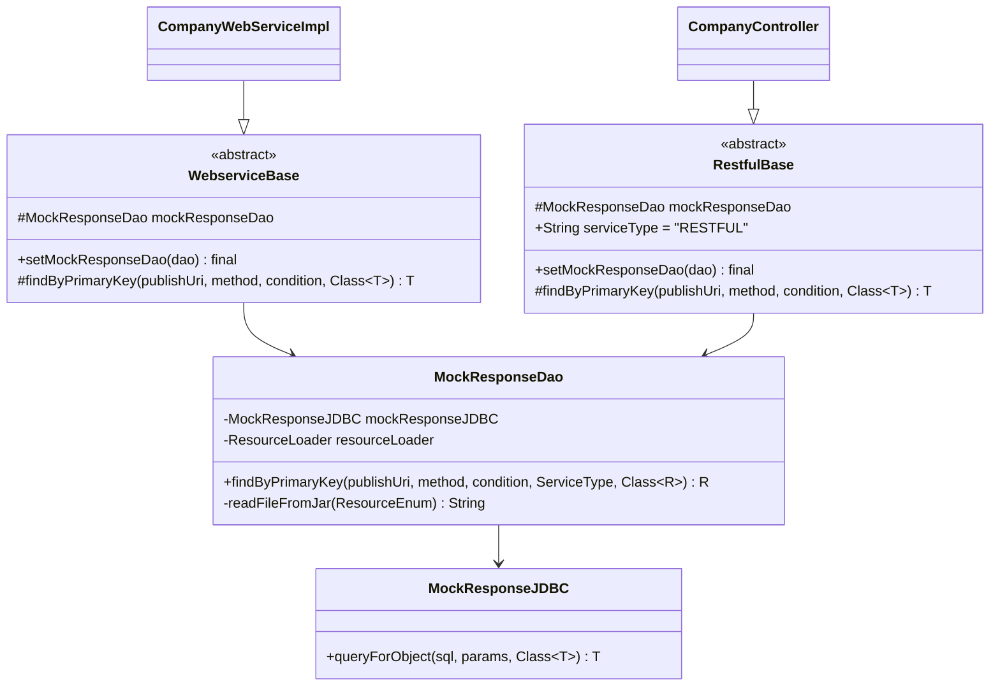
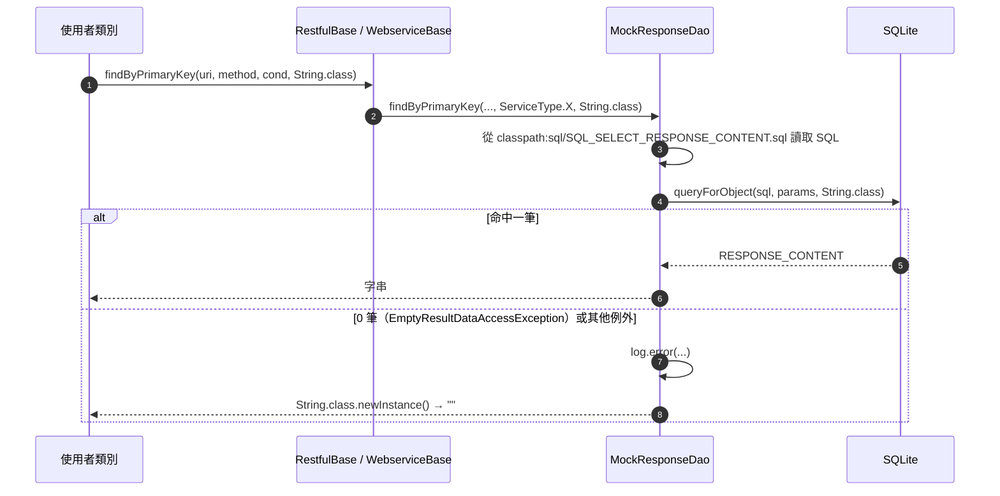

# 3.3 Mock 回應機制

## 設計概念

系統不解析請求、不實作規則引擎。比對邏輯交給使用者 JAR，系統只提供「以四個鍵查一段字串」的能力：

```
(publishUri, method, condition, serviceType) ──▶ response_content
```

這個分工讓系統保持簡單、與協定無關（SOAP、REST 共用同一張表），代價是 JAR 作者與回應維護者必須約定 `method` 與 `condition` 的格式。

## 元件



## 查詢流程



SQL：

```sql title="resources/sql/SQL_SELECT_RESPONSE_CONTENT.sql"
SELECT mr.RESPONSE_CONTENT AS content
FROM MOCK_RESPONSE mr
WHERE 1 = 1
  AND mr.PUBLISH_URI = :publishUri
  AND mr.METHOD = :method
  AND mr.CONDITION = :condition
  AND mr.SERVICE_TYPE = :serviceType
  AND mr.IS_ACTIVE = TRUE
```

## 設計重點

| 項目 | 設計 | 理由／影響 |
|---|---|---|
| SQL 來源 | 每次查詢都從 classpath 讀檔 | 讓 `MockResponseDao` 與 `ResourceEnum` 機制一致；每次查詢多一次資源讀取，對 Mock 情境可接受 |
| 查無資料 | 回傳空物件而非例外 | 避免使用者程式需要處理 Spring 例外；但容易讓錯誤延後到反序列化才出現 |
| 鍵值比對 | 等值比對、無正規化 | 結果可預測；JSON 欄位順序、空白差異都會導致不命中 |
| 啟用旗標 | 查詢條件包含 `IS_ACTIVE = TRUE` | 停用即時生效，不需快取失效 |
| 服務類型 | 由基底類別固定帶入 | 使用者不需（也無法）跨類型查詢 |
| 快取 | 無 | 回應修改立即生效 |

## 回應的寫入端

管理端以 JPA（`MockResponseRepository`）讀寫，以 JDBC 具名 SQL 處理批次更新與刪除：

| 操作 | 實作 |
|---|---|
| 新增 | `repository.save(entity)`，`IS_ACTIVE=false`，`ID=UUID` |
| 修改 | `SQL_DEL_RESPONSE`（依 `ID`）＋ 新增 |
| 切換 | `findByUuId` → `setIsActive` → `save` |
| 刪除 | `SQL_DEL_RESPONSE` |
| URI 連動 | `SQL_UPDATE_PUBLISH_URI_FOR_RESPONSE`（不分 `SERVICE_TYPE`） |

由於主鍵是 `(PUBLISH_URI, METHOD, CONDITION, SERVICE_TYPE)`，`save` 一個鍵值已存在的實體時，JPA 會執行 merge（覆寫），而不是報主鍵衝突。

## base-jar 與後端的關係

`base-jar/` 的 `jarbase`、`dao`、`jdbc`、`enums` 類別與後端 `com.dynamicapi` 同名且內容相同。設計上：

- **編譯期**：使用者專案依賴 `base.jar` 取得型別。
- **執行期**：父優先 ClassLoader 讓所有引用都解析到後端版本；`MockResponseDao` 是後端的 Spring Bean，SQL 檔也只存在於後端。

兩份程式碼需要手動保持一致（TD-08）。
