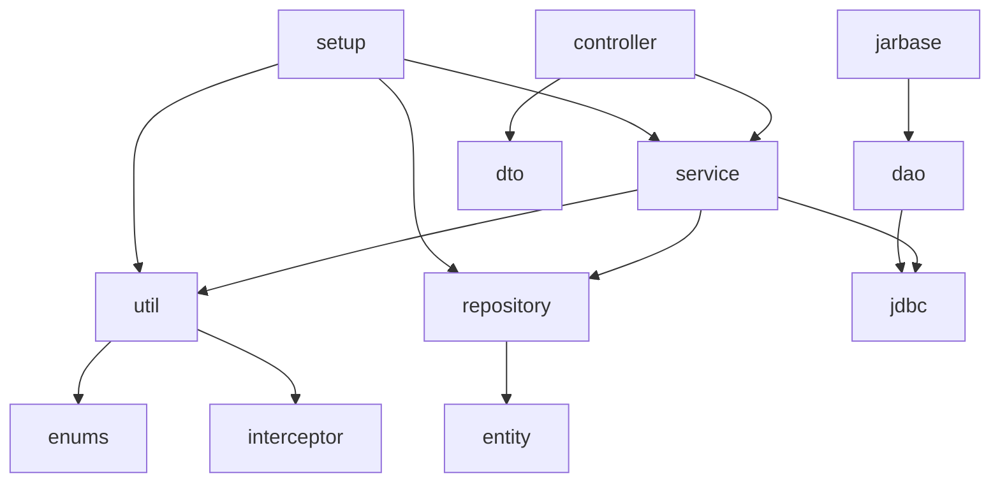

# 3.1 後端模組

## 套件結構

根套件 `com.dynamicapi`（`backend/src/main/java/com/dynamicapi/`）：

| 套件 | 主要類別 | 職責 |
|---|---|---|
| `controller` | `WebServiceController`、`DynamicLoadController`、`CommonController` | 管理 API |
| `service` / `service.impl` | `DynamicWebServiceImpl`、`DynamicControllerServiceImpl`、`CommonServiceImpl`、`BaseService` | 業務邏輯與交易 |
| `util` | `WebServiceHandler`、`DynamicBeanUtil`、`Wsdl2JavaUtil`、`DynamicClassLoader` | 動態發布、Bean 註冊、WSDL 轉換 |
| `setup` | `SetupWebservices`、`SetupController` | 啟動時恢復服務（`SmartLifecycle`） |
| `config` | `WebConfig`、`SpaController`、`CustomApiMappingsEndpoint` | CORS、SPA 路由、Actuator 端點 |
| `interceptor` | `CdataContentInterceptor`、`ResponseCdataInterceptor` | CXF CDATA 處理 |
| `jarbase` | `WebserviceBase`、`RestfulBase` | 提供給自訂 JAR 繼承 |
| `dao` | `MockResponseDao` | 執行期 Mock 回應查詢 |
| `jdbc` | `BaseJDBCAdapter`、`EndPointJDBC`、`ControllerJDBC`、`MockResponseJDBC` | 具名 SQL 查詢（SQL 檔在 `resources/sql/`） |
| `repository` | `EndpointRepository`、`ControllerRepository`、`JarFileRepository`、`MockResponseRepository` | Spring Data JPA |
| `entity` | `EndpointEntity`、`ControllerEntity`、`JarFileEntity`、`MockResponseEntity`、`MockResponseId` | JPA 實體 |
| `dto` / `model` | `EndpointDTO`、`ControllerDTO`、`MockResponseRequestDTO`、`WebServiceModel`… | 傳輸物件、查詢結果 |
| `enums` | `ClassLoaderSingletonEnum`、`JarFileStatus`、`ServiceType` | ClassLoader 登錄表、列舉 |
| `converter` | `JarFileStatusConverter` | `JarFileStatus` ↔ `A/I/D` |
| `exception` | `WebserviceException`、`ControllerException`、`GlobalExceptionHandler` | 例外 |
| `webservice` | `ExampleWebServiceImpl`、`ExampleUserServiceImpl` | 隨系統靜態發布的範例 SOAP 服務（`web.service.map`） |

## 分層與相依

`jarbase` / `dao` 由**動態載入的使用者類別**使用，不被管理層呼叫。

## 模組說明

### Endpoint 管理（`WebServiceController` + `DynamicWebServiceImpl` + `WebServiceHandler`）

| 方法 | 說明 |
|---|---|
| `getEndpoints` / `getEndpoint(id, publishUri)` | 以 `SQL_SELECT_ENDPOINT_RELATED_JAR_FILE` 聯結 `ENDPOINT` 與 `JAR_FILE` |
| `saveWebService` / `updateWebService` | 寫入 `ENDPOINT`（固定 `IS_ACTIVE=false`），JAR 狀態設為 `A`；`update` 直接呼叫 `save` |
| `enabledWebService(publishUri)` | 讀設定與 JAR → `WebServiceHandler.registerWebService` → `IS_ACTIVE=true` |
| `disabledWebService(dto)` | `WebServiceHandler.removeWebService` → `IS_ACTIVE=false` |
| `removeWebService(publishUri, jarFileId)` | 刪除設定、JAR 標記 `D` 並刪檔 |
| `generateWsdlToObjects` | 讀取 URL 或檔案內容後交給 `Wsdl2JavaUtil` |

### RESTful 管理（`DynamicLoadController` + `DynamicControllerServiceImpl`）

| 方法 | 說明 |
|---|---|
| `saveController` / `updateController` | 寫入 `CONTROLLER`（`IS_ACTIVE=false`），JAR 狀態 `A` |
| `enabledController(publishUri)` | `startUpControllerProcess` → `IS_ACTIVE=true` |
| `startUpControllerProcess` | 載入類別、驗證路徑、`createBean`、逐方法 `registerMapping` |
| `disabledController(dto)` | 逐方法 `unregisterMapping`、關閉 ClassLoader |
| `removeController` | 刪除設定、JAR 標記 `D` 並刪檔 |

### 共用功能（`CommonController` + `CommonServiceImpl`）

| 方法 | 說明 |
|---|---|
| `uploadJarFile` | 儲存為 `{UUID}.jar`，建立 `JAR_FILE`（`I`） |
| `getResponseContent` / `getResponseList` | 以 JPA 衍生查詢讀取回應 |
| `saveMockResponse` | 產生 UUID，`IS_ACTIVE=false` |
| `updateMockResponse(dto)` | 刪除（依 `ID`）後重新 `save` |
| `updateMockResponse(oriUri, newUri)` | `SQL_UPDATE_PUBLISH_URI_FOR_RESPONSE` 批次改 URI |
| `deleteMockResponse` / `switchMockResponse` | 依 `ID` 刪除／切換 |
| `streamLogFile` | `SseEmitter`（30 秒逾時）+ `WatchService` 監看檔案；以 `CachedThreadPool` 執行 |

### WSDL 轉換（`Wsdl2JavaUtil`）

以全域鎖序列化執行：建立工作目錄 → 寫入暫存 WSDL → `WSDLToJava.main(-autoNameResolution -d <dir> [-p pkg] -client <wsdl>)` → 將產出打包成 ZIP → 讀入記憶體 → 刪除整個工作目錄。

### 啟動恢復（`SetupWebservices`、`SetupController`）

實作 `SmartLifecycle.start()`，於應用程式內容完成刷新後執行；分別查詢 `IS_ACTIVE=true` 的 Endpoint / Controller 逐一載入，失敗者改為停用。`isRunning()` 固定回傳 `false`、`stop()` 為空，因此關閉時不會主動撤銷服務。

### 其他

| 類別 | 說明 |
|---|---|
| `SpaController` | 將 `/endpoint`、`/restful`、`/response`、`/test-api`、`/about`（含結尾斜線）對應到 `static/{page}.html` |
| `WebConfig` | `/` 轉送 `index.html`；全域 CORS 允許 `http://localhost:3000` |
| `CustomApiMappingsEndpoint` | Actuator `show-mappings`：列出已啟用 RESTful 對應的 `RequestMappingInfo` |
| `DynamicClassLoader` | 繼承 `CustomClassLoader` 並公開 `addURL`，目前**未被使用** |
| `util/JsonToXmlTest` | 置於 main 原始碼中的實驗程式，未被引用 |
