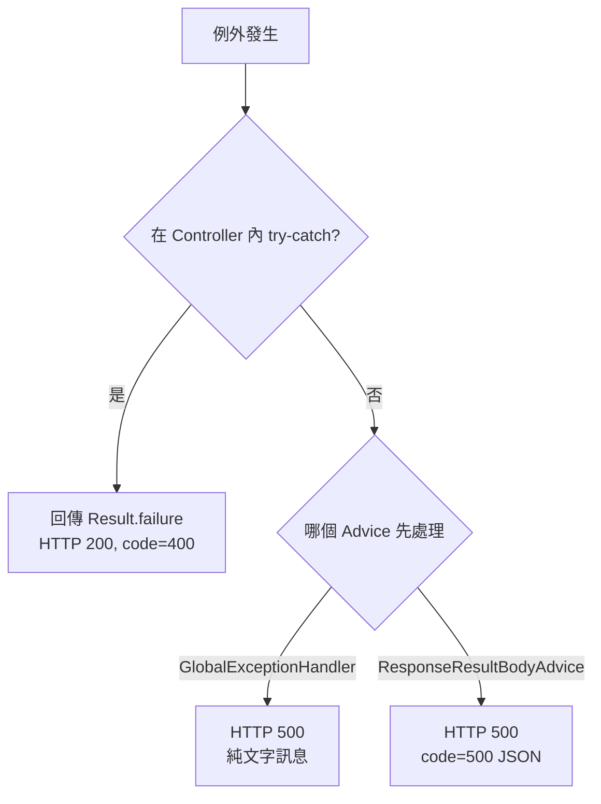

# 7. 安全性與錯誤處理設計

## 7.1 認證與授權

**目前沒有任何認證與授權機制。** 管理 API、動態服務、Actuator 皆可匿名存取。

| 風險 | 說明 |
|---|---|
| 遠端程式碼執行 | 上傳 JAR 並啟用即可在 JVM 內執行任意程式碼，權限等同後端行程 |
| 資料竄改 | 任何人可修改、刪除服務與回應 |
| 任意檔案讀取 | `/common/logs/stream` 的 `logFileName` 可用 `..` 跳出日誌目錄 |

**部署要求**：僅部署於受信任的內部網路；需共用時，於前方加上具認證的反向代理（例如只允許 VPN 網段、Basic Auth、SSO）。

**建議的改善方向**：

1. 引入 Spring Security，至少對 `/ws/**`、`/api/**`、`/common/**`、`/actuator/**` 要求登入；動態服務路徑維持匿名。
2. `logFileName` 以 `Path.normalize()` 後檢查仍位於 `log.base` 底下。
3. 上傳 JAR 時檢查內容（至少確認是合法 ZIP、類別未使用 `com.dynamicapi` 套件）。

## 7.2 資料保護

| 項目 | 現況 |
|---|---|
| 傳輸加密 | 未設定 HTTPS |
| 儲存加密 | SQLite 檔與 JAR 檔皆為明文 |
| 機密設定 | 無（SQLite 不需帳密；`dynamic.is-encrypt=false`） |
| 個資 | 系統本身不收集；Mock 回應內容由使用者決定，建議使用假資料 |

## 7.3 例外與錯誤處理策略

### 例外類型

| 例外 | 拋出位置 | 典型訊息 |
|---|---|---|
| `WebserviceException` | Endpoint 相關服務、`CommonServiceImpl`、`BaseService.getJarFile` | 找不到對應的 Jar 檔案、啟動 Webservice 失敗、更新 Mock Response 失敗 |
| `ControllerException` | `DynamicControllerServiceImpl` | 無法讀取 ClassPath、路徑不一致、Controller 卸載服務失敗 |
| `EntityExistsException` / `PersistenceException` | `saveWebService` | 持久化失敗 |

### 處理層次



| 層次 | 行為 |
|---|---|
| Controller 驗證 | 必填欄位空白 → `Result.failure(BAD_REQUEST)`，記錄錯誤日誌 |
| Controller try-catch | `saveWebService`、`updateResponse` 捕捉例外 → `code=400`；`switchResponse` 捕捉後回傳成功 |
| `GlobalExceptionHandler` | 處理 `WebserviceException`、`ControllerException` 與所有 `Exception`，回傳 HTTP 500 與 `e.getMessage()` 純文字 |
| zipe `ResponseResultBodyAdvice` | 同樣處理 `Exception`，回傳 HTTP 500 與 `{code:500}` |
| 動態載入 | 失敗時清理 ClassLoader 登錄、維持停用狀態 |
| 啟動恢復 | 個別失敗不中斷，改為停用 |
| Mock 查詢 | 吞掉例外，回傳空物件 |

:::caution `GlobalExceptionHandler` 的參數型別
`handleCustomException` 同時宣告處理 `WebserviceException` 與 `ControllerException`，但方法參數型別是 `WebserviceException`。當 `ControllerException` 進入此方法時會因參數型別不符而無法正確呼叫（TD-06）。應改為共同父型別 `RuntimeException`。
:::

### 建議的統一錯誤格式

統一由單一 Advice 處理，HTTP 狀態碼與 `code` 一致，並帶入可讀訊息：

```json
{ "code": 500, "message": "Controller 註冊服務失敗，路徑不一致", "data": null }
```
