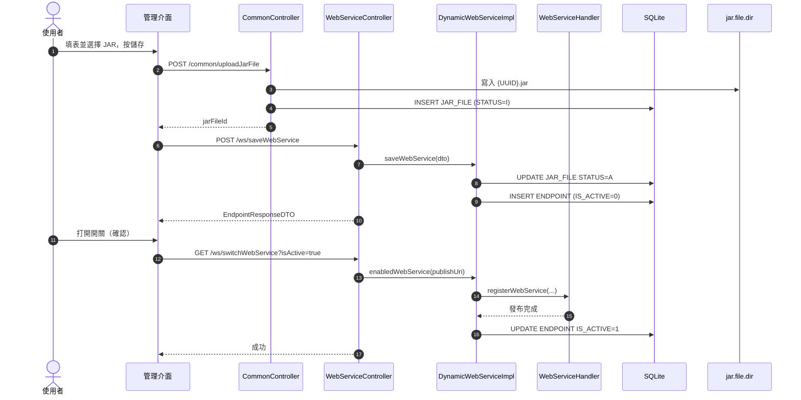
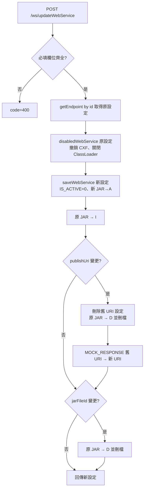
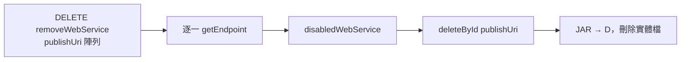
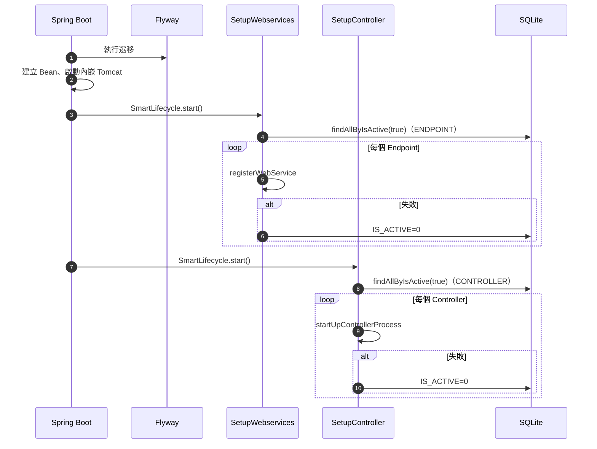
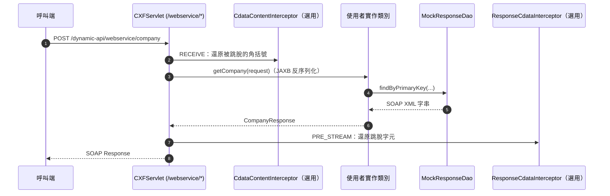

# 6. 業務流程與演算法設計

## 6.1 新增並啟用 Endpoint



RESTful 的流程相同，第 13 步改為 `DynamicControllerServiceImpl.startUpControllerProcess`。

## 6.2 編輯服務

以 Endpoint 為例（RESTful 相同，僅多一步 JAR→`I`）：



步驟 H 不檢查新設定是否仍引用原 JAR，是 KI-02 的成因。

## 6.3 刪除服務



## 6.4 系統啟動恢復



## 6.5 執行期請求處理

### SOAP



### REST

`DispatcherServlet` → `RequestMappingHandlerMapping`（含動態註冊的對應）→ 使用者 Controller 方法 → `findByPrimaryKey` → 回傳值經 `@ResponseResultBody` 包裝（若有標註）。

## 6.6 核心演算法

### RESTful 路徑驗證

```java
String routePath = classRequestMapping != null ? classRequestMapping.value()[0] : "";
if (StringUtils.isNotBlank(routePath) && !routePath.split("/")[1].equals(publishUri)) {
    throw new ControllerException("Controller 註冊服務失敗，路徑不一致");
}
```

- 類別沒有 `@RequestMapping` 時不驗證（路由直接使用方法路徑，可能與 Publish URI 無關）。
- `routePath` 必須以 `/` 開頭，否則 `split("/")[1]` 會取到第二段或越界。

### 日誌末尾讀取

`getLastNLines` 以 `RandomAccessFile` 從檔尾逐位元組往前讀，遇到 `\n` 即完成一行；每行以 ISO-8859-1 取回位元組再以 UTF-8 解碼，以正確處理中文。
