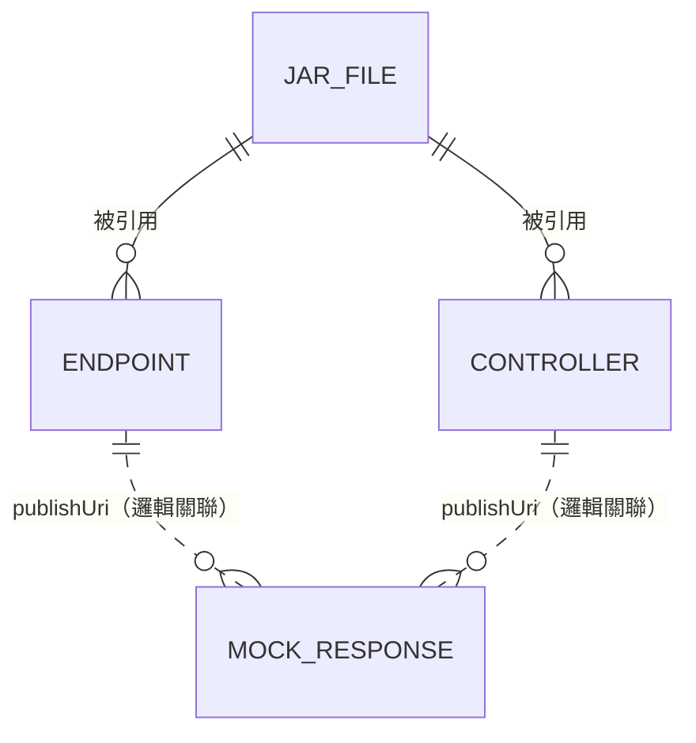
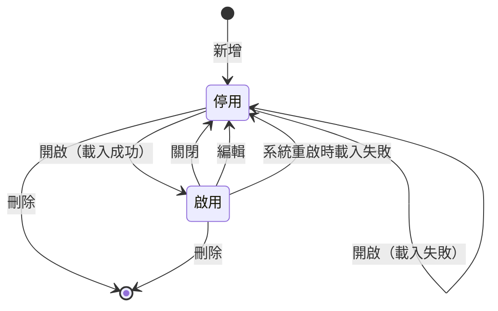

# 6. 資料與業務規則概要

## 6.1 重要資料物件

| 物件 | 說明 | 識別 |
|---|---|---|
| JAR 檔案 | 上傳的程式庫，實體存於檔案系統 | `ID`（UUID） |
| Endpoint | SOAP 服務設定 | `PUBLISH_URI` |
| RESTful（Controller） | REST 服務設定 | `PUBLISH_URI` |
| Mock 回應 | 預設的回應內容 | `(PUBLISH_URI, METHOD, CONDITION, SERVICE_TYPE)`；另有 `ID`（UUID）供介面操作 |

完整欄位定義見 [SDD 4. 資料設計](../sdd/data.md)。

## 6.2 關鍵欄位與約束

| 欄位 | 約束 |
|---|---|
| Endpoint / Controller 的 `PUBLISH_URI` | 各自表內唯一，最長 100 字元；建議只用英數字與 `-`、`_` |
| `BEAN_NAME` | 最長 50 字元；全系統 Bean 名稱不可衝突 |
| `CLASS_PATH` | 最長 100 字元，完整類別名稱 |
| `JAR_FILE.NAME` | 最長 40 字元，系統產生的 `{UUID}.jar` |
| `JAR_FILE.STATUS` | `A`、`I`、`D` |
| `MOCK_RESPONSE.METHOD` | 最長 50 字元 |
| `MOCK_RESPONSE.CONDITION` | 文字，無長度限制；與其他三欄組成主鍵 |
| `MOCK_RESPONSE.SERVICE_TYPE` | `ENDPOINT` 或 `RESTFUL` |
| 各表 `IS_ACTIVE` | `0` 停用、`1` 啟用 |

## 6.3 共通業務規則

| 編號 | 規則 |
|---|---|
| BR-01 | Endpoint、RESTful、Mock 回應**新建與編輯後一律為停用**，必須明確啟用 |
| BR-02 | 只有啟用中的 Mock 回應會被執行期查詢命中 |
| BR-03 | Mock 回應以四鍵**完全相等**比對，不做正規化 |
| BR-04 | RESTful 的 Publish URI 必須等於 Controller 類別路徑第一段 |
| BR-05 | 服務 Publish URI 變更時，Mock 回應隨之搬移 |
| BR-06 | 刪除服務時刪除其 JAR 檔，保留 Mock 回應 |
| BR-07 | 系統啟動時自動恢復啟用中的服務；失敗者改為停用 |
| BR-08 | 同一 JAR 的狀態轉換依 [FR-JAR-002](./functional/jar.md#fr-jar-002-jar-狀態管理) |

### 服務狀態流轉（Endpoint／RESTful）

