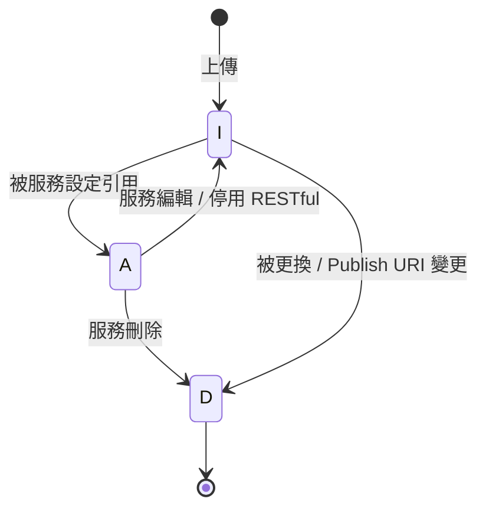

# 3.1 JAR 檔案管理

JAR 檔案沒有獨立的管理畫面；它在建立或編輯 Endpoint / RESTful 時一併上傳，生命週期跟隨使用它的服務。

## FR-JAR-001 上傳 JAR 檔案

| 項目 | 內容 |
|---|---|
| 描述 | 系統應接受使用者上傳的 JAR，存放於檔案系統並建立 JAR 記錄 |
| 觸發者 | 管理介面（新增／編輯服務時選擇檔案）、管理 API `POST /common/uploadJarFile` |
| 前置條件 | 無 |
| 後置條件 | 檔案以 `{UUID}.jar` 存於 `jar.file.dir`；`JAR_FILE` 新增一筆，狀態 `I`（未使用）；回傳 `jarFileId`、`jarFileName` |
| 業務規則 | 1. 檔案不可為空，原始檔名需以 `.jar` 結尾，否則回應 `code=400` 2. 單檔上限 100MB（`spring.servlet.multipart.max-file-size`） 3. 存放目錄不存在時自動建立 4. 不保留原始檔名；同一檔案重複上傳會產生不同記錄 |
| 驗收標準 | ✅ 上傳合法 JAR 取得 `jarFileId`，`jar.file.dir` 出現對應檔案 ❌ 上傳 `.zip`、空檔案回應 `code=400` |

## FR-JAR-002 JAR 狀態管理

| 項目 | 內容 |
|---|---|
| 描述 | 系統應依服務的生命週期維護 JAR 狀態 |
| 狀態值 | `A` 使用中、`I` 未使用、`D` 已刪除 |
| 業務規則 | 見下表與狀態圖 |
| 驗收標準 | 每個轉換觸發點執行後，`JAR_FILE.STATUS` 與實體檔案存在與否符合下表 |

| 觸發點 | 結果狀態 | 實體檔案 |
|---|---|---|
| 上傳 | `I` | 建立 |
| 建立／編輯儲存服務（新設定所用的 JAR） | `A` | 保留 |
| 編輯服務（原設定所用的 JAR） | `I` | 保留 |
| 編輯服務且更換了 JAR（原 JAR） | `D` | 刪除 |
| 編輯服務且變更 Publish URI（原 JAR） | `D` | 刪除 |
| 停用 RESTful | `I` | 保留 |
| 刪除服務 | `D` | 刪除 |

:::warning 已知問題（KI-02）
變更 Publish URI 但沿用同一個 JAR 時，該 JAR 仍被新設定引用卻被標為 `D` 並刪除檔案，導致之後無法啟用。**期望行為**：只有在沒有任何服務引用時，才可把 JAR 標為 `D` 並刪除檔案。
:::

:::note 未提供的功能
前版 SRS 中的「查詢 JAR 清單」「單獨刪除 JAR」目前未實作；JAR 只能透過服務的建立、編輯、刪除間接管理。狀態為 `I` 的 JAR 不會被自動清除。
:::
