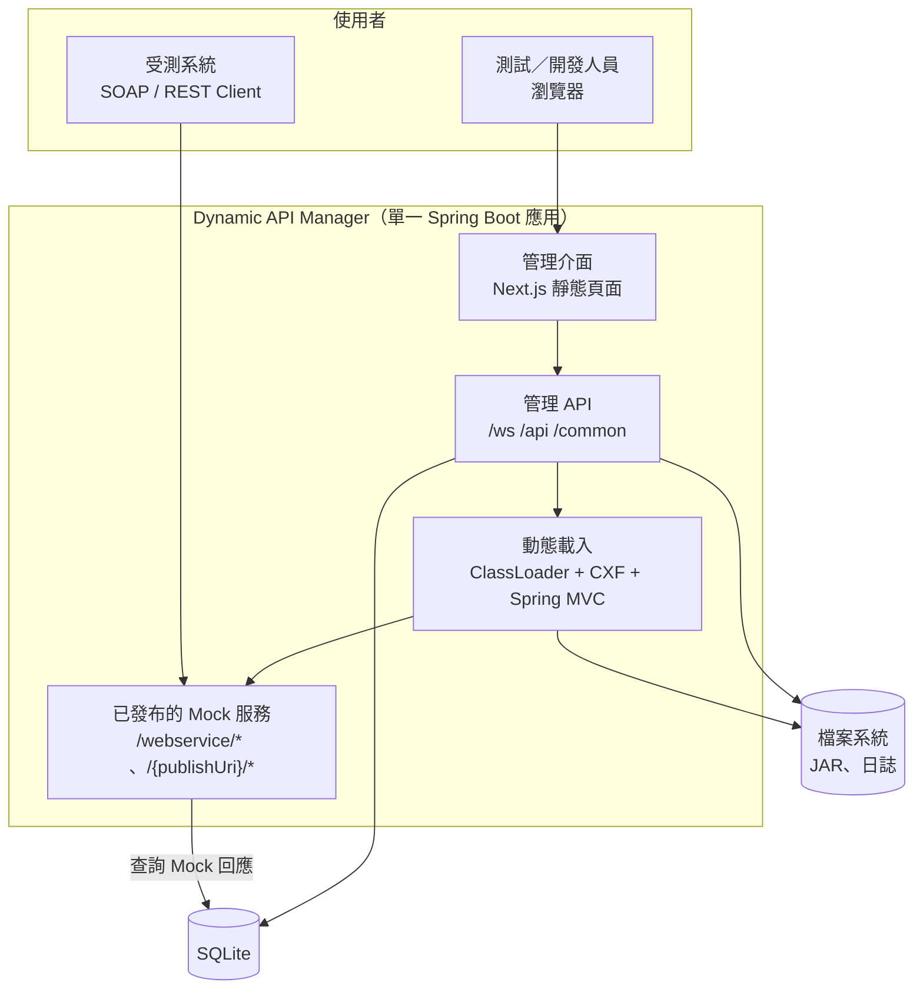

# 2. 系統概述

## 2.1 系統目標

| 編號 | 目標 | 衡量方式 |
|---|---|---|
| G-01 | 新增或更新 Mock 服務**不需重啟**伺服器 | 從上傳 JAR 到服務可呼叫，全程僅透過管理介面／API 完成 |
| G-02 | 測試人員可**自行維護**回應內容 | 新增、修改、切換回應不需要開發人員或重新部署 |
| G-03 | 同時支援 **SOAP 與 REST** | 兩種服務類型使用一致的管理流程 |
| G-04 | 服務**可重現** | 系統重啟後，已啟用的服務自動恢復 |
| G-05 | 降低 SOAP 開發門檻 | 由 WSDL 直接產生 Java 類別 |

## 2.2 目標使用者與利害關係人

| 角色 | 說明 | 主要需求 |
|---|---|---|
| 測試人員（QA） | 依測試案例準備各種回應 | 快速新增、切換回應；查詢失敗原因 |
| 開發人員（服務使用方） | 串接尚未就緒的外部服務 | 可呼叫、行為可預期的 Mock |
| JAR 作者 | 撰寫可載入的 Endpoint / RESTful 類別 | 清楚的開發規範與基底類別 |
| 維運人員 | 部署與維護系統 | 單一 JAR 部署、可設定的檔案路徑、日誌 |

本系統**沒有登入機制**，所有能連到管理介面的人都具備完整權限（見 [4. 非功能性需求](./non-functional.md#43-安全性與隱私)）。

## 2.3 主要使用情境

詳見 [2.3 使用情境](./use-cases.md)，摘要如下：

| 編號 | 情境 |
|---|---|
| UC-01 | 部署新的 SOAP Mock 服務 |
| UC-02 | 部署新的 RESTful Mock 服務 |
| UC-03 | 為服務新增多組情境回應 |
| UC-04 | 測試中切換回應情境 |
| UC-05 | 更新服務的 JAR 版本 |
| UC-06 | 由 WSDL 產生 Java 類別 |
| UC-07 | 系統重啟後恢復服務 |

## 2.4 高階系統架構

系統以單一行程運作：管理介面在生產模式下由後端直接提供；動態載入的服務與管理 API 共用同一個 port（8080）與 context path（`/dynamic-api`）。
