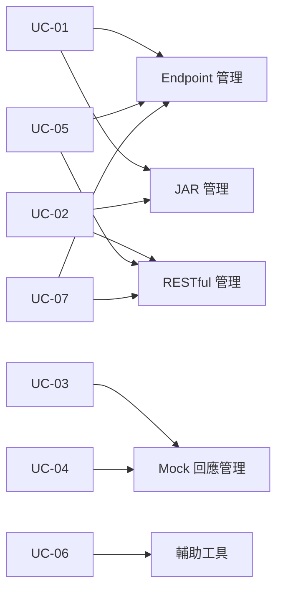

# 2.3 使用情境

## UC-01 部署新的 SOAP Mock 服務

| 項目 | 內容 |
|---|---|
| 主要角色 | JAR 作者、測試人員 |
| 前置條件 | 已有繼承 `WebserviceBase` 的 Endpoint JAR |
| 主要流程 | 1. 在 Endpoint 頁面新增，填入 Publish URI、Bean 名稱、Class 路徑並選擇 JAR → 2. 系統上傳 JAR、建立停用中的 Endpoint → 3. 打開開關 → 4. 系統載入類別並發布 → 5. 使用者以 `?wsdl` 驗證 |
| 替代流程 | 4a. 類別載入或發布失敗：開關維持關閉，顯示錯誤訊息 |
| 後置條件 | `/dynamic-api/webservice/{publishUri}` 可被呼叫 |
| 相關需求 | FR-JAR-001、FR-EP-001、FR-EP-002 |

## UC-02 部署新的 RESTful Mock 服務

| 項目 | 內容 |
|---|---|
| 主要角色 | JAR 作者、測試人員 |
| 前置條件 | 已有繼承 `RestfulBase`、標註 `@RestController` 的 JAR |
| 主要流程 | 1. 在 RESTful 頁面新增，填入 Publish URI、Class 路徑並選擇 JAR → 2. 打開開關 → 3. 系統驗證路徑、註冊所有對應 → 4. 使用者呼叫 API 驗證 |
| 替代流程 | 3a. 類別路徑第一段與 Publish URI 不同：啟用失敗 |
| 後置條件 | `/dynamic-api/{publishUri}/...` 可被呼叫 |
| 相關需求 | FR-JAR-001、FR-RS-001、FR-RS-002 |

## UC-03 為服務新增多組情境回應

| 項目 | 內容 |
|---|---|
| 主要角色 | 測試人員 |
| 前置條件 | 服務已建立；已知該 JAR 的 method 與 condition 格式 |
| 主要流程 | 1. 從服務清單進入回應清單 → 2. 依情境各新增一筆回應（不同 condition）→ 3. 啟用 → 4. 以不同請求呼叫並取得對應回應 |
| 後置條件 | 同一個 API 可依請求回傳不同內容 |
| 相關需求 | FR-MR-001、FR-MR-004、FR-MR-006 |

## UC-04 測試中切換回應情境

| 項目 | 內容 |
|---|---|
| 主要角色 | 測試人員 |
| 主要流程 | 1. 編輯既有回應內容或切換開關 → 2. 下一次呼叫立即取得新結果 |
| 規則 | 不需要重新啟用服務；回應編輯後需重新啟用 |
| 相關需求 | FR-MR-003、FR-MR-004 |

## UC-05 更新服務的 JAR 版本

| 項目 | 內容 |
|---|---|
| 主要角色 | JAR 作者 |
| 主要流程 | 1. 編輯服務並選擇新 JAR → 2. 系統停用舊服務並保存新設定（停用）→ 3. 重新啟用 → 4. 新類別生效 |
| 後置條件 | 舊 JAR 狀態為未使用；Mock 回應保留 |
| 相關需求 | FR-EP-004、FR-RS-004 |

## UC-06 由 WSDL 產生 Java 類別

| 項目 | 內容 |
|---|---|
| 主要角色 | JAR 作者 |
| 主要流程 | 1. 在 Endpoint 頁面開啟轉換工具 → 2. 上傳 WSDL 檔或輸入 URL → 3. 下載 ZIP |
| 相關需求 | FR-TOOL-001 |

## UC-07 系統重啟後恢復服務

| 項目 | 內容 |
|---|---|
| 主要角色 | 系統（自動） |
| 主要流程 | 1. 應用程式啟動 → 2. 讀取所有啟用中的 Endpoint 與 RESTful → 3. 逐一載入並發布 |
| 替代流程 | 3a. 單一服務載入失敗：將其改為停用並記錄日誌，繼續處理其他服務 |
| 相關需求 | FR-EP-007、FR-RS-007 |

## 情境與需求對照

